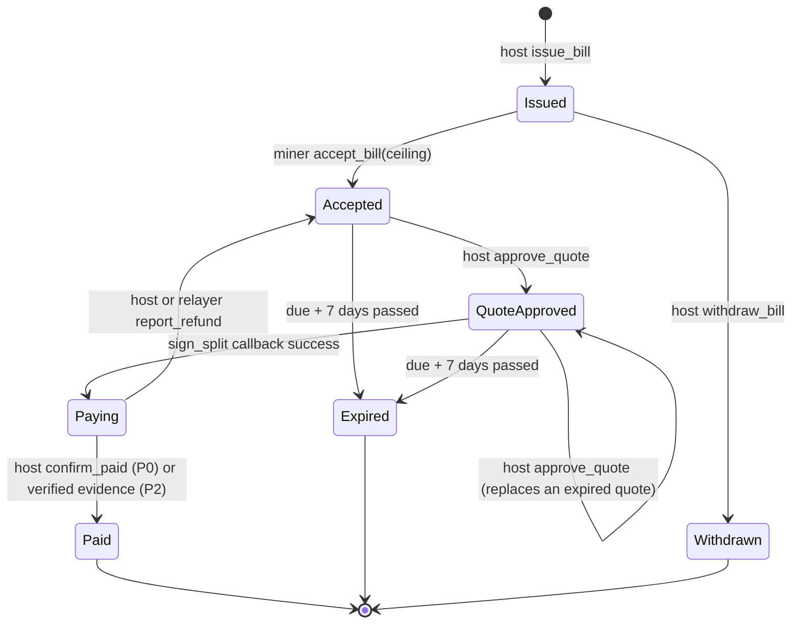
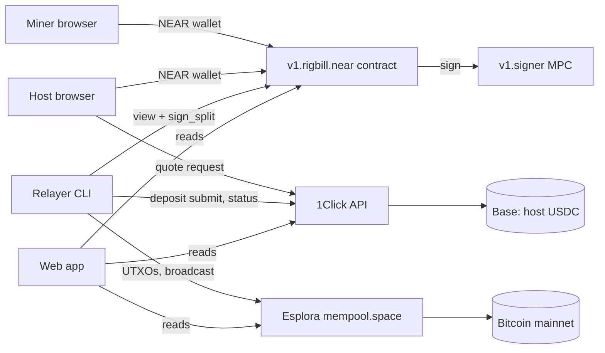

# Rigbill Project Plan

## Document Control

- Status: Approved for execution (planning complete)
- Version: 1.0
- Created: 2026-11-12
- Last updated: 2026-11-12
- Planning mode: Standard, compressed for a hackathon deadline. Real funds on mainnet and a signing authority raise the risk above Lean.
- Research depth: Standard
- Planning confidence: 74 / 100 (Medium). See Planning Audit.
- Intended audience: the executor building Rigbill in this repository, and MystiqueMide as approver
- Source request summary: Build the approved hackathon idea "non-custodial miner payout splitter, host-first" under the name Rigbill. Plan it as functional vertical slices for the NEAR HACKATHON Real-World Money track, deadline 2026-11-14 23:59 UTC.
- Repository hygiene: this file and `PROJECT_STATE.md` are internal. They are excluded from git through `.git/info/exclude` and must never be committed to the public repository.

---

## Executive Summary

Bitcoin miners earn BTC but pay hosting bills in dollars. Today they either let a custodial pool convert their payouts or sell by hand every month. Hosts protect themselves by taking about 30 days of power up front.

Rigbill gives each miner a Bitcoin payout address that no person or server holds a key to. A NEAR contract controls it through Chain Signatures. When a payout arrives, the contract will only sign a Bitcoin transaction that pays the host's open bill, through NEAR Intents as USDC on the host's chain, and sends the rest to the miner's cold wallet. While a bill is open, nothing leaves the address without paying it.

The first version is a minimal working product on NEAR mainnet and Bitcoin mainnet with tiny amounts. It has three actors: the miner, the host and a permissionless relayer. One full real loop has to work end to end, proven by explorer links, plus three enforced refusals.

---

## Project Definition

| Field | Value | Label |
|---|---|---|
| Name | Rigbill | Confirmed |
| One sentence | A Bitcoin payout address that pays the miner's hosting bill in USDC first and sends the rest to cold storage, with no company holding the keys. | Confirmed |
| Category | Blockchain payments product, hackathon build | Confirmed |
| Hackathon | NEAR HACKATHON, development ends 2026-11-14T23:59:00Z | Verified (HACKATHON.md) |
| Tracks | `realworld` primary, `business` secondary | Confirmed |
| Deliverables | Public repo, X demo post with video, submission form | Verified (HACKATHON.md) |
| Network | NEAR mainnet, Bitcoin mainnet, Base mainnet (USDC). Intents has no testnet. | Verified (HACKATHON.md Q-007) |
| Budget | Mainnet costs paid by the builder: roughly 5-8 NEAR plus ~80,000 sats (~$60) including fees | Assumed |
| Team | MystiqueMide, solo | Inferred |

## Problem Statement

- Miners' revenue is in BTC while hosting, power, repairs and payroll are billed in fiat or stablecoins. An industry analyst calls this the two-currency problem. (Verified: Digital Mining Solutions, 2026-05-19)
- A miner on the non-custodial OCEAN pool: "I have to pay for hosting costs monthly in USD." Their workaround is selling hashrate contracts. (Verified: Stacker News, Sep 2025)
- Hosts take about 30 days of estimated power up front because clients pay late. (Verified: Simple Mining hosting guide)
- Existing conversion only works on custodial balances (ViaBTC hourly auto-conversion, Kryptex, 2miners, Binance Pool), host netting (Miningstore), or a custodial hashrate market (NiceHash USDT market). Non-custodial pools like OCEAN pay straight to an address and offer no conversion. (Verified: provider docs and pages)
- Current workaround for non-custodial miners: sell manually each month, use OTC, hold reserves.

## Target Users or Audience

| Actor | Role | What they need | Natural surface |
|---|---|---|---|
| Miner (primary) | Owns rigs, points pool payouts to the Rigbill address | Pay hosting from payouts without giving custody to anyone. Keep the rest in cold storage. | Web app with a NEAR wallet: setup, payout address, accept bills, ledger |
| Host (secondary) | Hosting or colocation provider | Get paid on time, in USDC, without chasing clients or holding deposits | Web app with a NEAR wallet: issue bill, approve quote, see paid status |
| Relayer (secondary, permissionless) | Anyone who runs the worker, the builder in the demo | Turns a payout into a valid split transaction and broadcasts it | CLI worker |
| Judges (audience) | Human judges, plus Claude Code and Codex screening | Reproduce, verify claims, see real proof | README, `npm run verify`, X video |

---

## Locked Winning Core

**Problem:** Miners earn BTC and owe hosting in dollars. The only automatic conversion today is custodial.

**Primary actor:** The miner.

**Secondary actors:** The hosting provider, and the permissionless relayer.

**Job to be done:** "Pay my hosting bill out of my mining payouts automatically, keep everything else in my own cold wallet, and never hand custody to anyone."

**Natural interaction surface:** A two-role web app (miner view and host view) with NEAR wallet login, plus a relayer CLI worker. The miner's real setup step is pasting the Rigbill payout address into their pool settings.

**Winning mechanism:** A Bitcoin address controlled by a NEAR contract through Chain Signatures. The contract computes the Bitcoin sighash itself from structured transaction data and refuses to sign unless the outputs match the split rule. The host's share is delivered as USDC on Base through a NEAR Intents 1Click deposit address that the host approved.

**Sponsor dependency:**
- NEAR Chain Signatures (`v1.signer`): the only key to the payout address. Without it you need a server holding a hot key or a custodial pool.
- NEAR Intents 1Click: native BTC to USDC on the host's chain with no exchange account.
- A NEAR smart contract holds all rules and state.

**Winning invariant:** Nothing leaves the payout address except to the host's approved bill or the miner's cold wallet. While a bill is open, nothing leaves without paying it.

**Positive proof:** One Bitcoin mainnet transaction spending from the derived address, with exactly two outputs: the host's approved 1Click deposit address and the miner's cold address. It's linked to the NEAR transaction that requested the MPC signature. The 1Click status reaches SUCCESS, and USDC arrives at the host's Base address on Basescan.

**Negative proof:** Three NEAR mainnet transactions that the contract rejects with readable errors, and no Bitcoin transaction follows any of them:
1. A cold-only sweep while a bill is open: `BILL_OPEN_HOST_OUTPUT_REQUIRED`
2. A third output added: `OUTPUT_NOT_ALLOWED`
3. An outpoint already signed: `OUTPOINT_ALREADY_SIGNED`

## Core Operational Loop

```text
Miner's pool (stand-in: miner's own wallet in the demo)
-> sends 50,000 sats to the miner's Rigbill payout address (derived from v1.rigbill.near + path "miner/<miner_account_id>")
-> relayer detects the confirmed UTXO via the Esplora API, reads the miner's open bill and the host's approved quote from the contract
-> relayer calls rigbill.sign_split(miner, inputs, outputs) with structured tx fields
-> contract checks: outputs are exactly {approved 1Click deposit address: approved amount_in_sats, cold address: remainder}, fee is under the miner's cap, outpoints are unused, bill is in Accepted state with an unexpired approved quote
-> contract builds the BIP143 sighash for each input and calls v1.signer.sign (Chain Signatures, domain 0, ECDSA)
-> callback stores the signatures, marks the outpoints spent, moves the bill to Paying, and emits an event
-> relayer reads the signatures, verifies them against the derived public key, assembles witnesses, broadcasts via Esplora, and submits the deposit tx hash to 1Click
-> 1Click swaps BTC to USDC on Base and delivers it to the host's address (NEAR Intents)
-> host sees the bill go Paying -> Paid, with links: BTC tx, NEAR sign tx, 1Click status, Basescan USDC transfer
-> miner's ledger shows the payout line: received, host paid, sent to cold, fee, all as explorer links
```

## Primary Actor Journey

1. Miner opens Rigbill and signs in with a NEAR wallet.
2. Miner registers: cold wallet address (bech32), and an absolute fee cap in sats (default 3,000).
3. Rigbill shows the miner's payout address, derived live from `v1.signer.derived_public_key`, with a copy button and a mempool.space link.
4. Miner pastes the address into their pool's payout settings. In the demo, the miner sends from their own wallet instead.
5. Host signs in, issues a bill to the miner: USD amount, period label, due date, host's Base USDC address.
6. Miner sees the bill and accepts it with a sats ceiling. The UI pre-fills the ceiling from a live 1Click dry quote plus 5%. The miner can't cancel an accepted bill. It releases only when Paid or after expiry.
7. Host approves a live 1Click EXACT_OUTPUT quote: the UI requests the quote (recipient = host Base address, refundTo = miner payout address), and the host signs `approve_quote` with deposit address, amount_in_sats, and quote deadline. The contract refuses if amount_in_sats is above the miner's ceiling.
8. A payout lands. The relayer splits it. Bitcoin confirms, 1Click delivers USDC.
9. Host marks the bill Paid after seeing the Basescan link in the app, or the relayer does so automatically when 1Click reports SUCCESS (see DEC-003).
10. Later payouts with no open bill go entirely to cold storage.

---

## Scope

### Core scope (P0, functional winning core)

- NEAR contract `v1.rigbill.near`: miner registry, bill lifecycle, quote approval, split validation, BIP143 sighash, outpoint registry, Chain Signatures calls, events
- Relayer CLI: watch the address, build structured tx, call the contract, assemble witness, verify the signature, broadcast, submit to 1Click, track status
- Web app: miner view (setup, payout address, bill accept, ledger) and host view (issue bill, approve quote, paid status), with NEAR wallet sign-in
- One real mainnet positive loop, and three real mainnet negative transactions
- `npm run verify`: a read-only script that prints contract state and explorer links without keys
- README, LICENSE (MIT), X demo video, submission

### Supporting scope (P1, product credibility)

- Live payout address balance and UTXO list from Esplora
- Bill status timeline with real sources
- Readable error messages for every contract rejection
- Refresh-safe state: everything loads from the contract and APIs, nothing from local storage alone
- Coinbase maturity and the 1Click minimum shown in the UI where relevant

### Future scope (build only if time remains, P2 and P3)

- Trustless Paid: use `v1.signer.verify_foreign_transaction` on the Base USDC transfer (Base is in the mainnet supported set) so Paid becomes MPC-verified on-chain
- Meta transactions so the miner and host never need NEAR for gas (matches the Real-World Money track hint)
- RedStone BTC price cap as a second check on quote approval
- Multiple bills per period, partial payments, multiple hosts per miner
- Fee bumping (RBF)

### Explicit exclusions

- No pool API integrations. Any pool that pays to an address works.
- No price floor or trading logic
- No token, no AI, no agent features
- No Taproot, Runes or Ordinals
- No USDC custody by Rigbill. USDC goes straight to the host.
- No analytics or charts
- No Templar GPL code. Use the MIT or Boost licensed libraries only.

## Success Criteria

| ID | Criterion | Measure |
|---|---|---|
| SC-1 | Real positive loop | Four public links exist for one run: BTC split tx, NEAR sign tx, 1Click SUCCESS status, Basescan USDC transfer to the host |
| SC-2 | Invariant enforced | Three failed NEAR mainnet txs with the three error codes, and no matching BTC tx |
| SC-3 | Actor-operable | Miner and host can complete their steps in the web app from a fresh browser with only a NEAR wallet |
| SC-4 | Reproducible | `npm run verify` works from a fresh clone with no secrets and prints the live state and links |
| SC-5 | Submitted | Repo public, X post live with the video, submission API returns 201, all before 2026-11-14T23:59Z |

---

## Requirements

### Functional requirements

| ID | Requirement |
|---|---|
| FR-001 | A miner can register with a cold address and a fee cap. Only the miner's own NEAR account can change them. |
| FR-002 | The app shows the miner's payout address, derived from `v1.signer.derived_public_key(path="miner/<miner_id>", predecessor="v1.rigbill.near", domain_id=0)` and encoded as P2WPKH bech32. |
| FR-003 | A host can issue a bill to a registered miner: usd_cents, period label, due timestamp, host Base address. |
| FR-004 | A miner can accept a bill with a sats ceiling. An accepted bill can't be cancelled by the miner. |
| FR-005 | A host can approve one 1Click quote per accepted bill: deposit address, amount_in_sats, quote deadline. The contract rejects amount_in_sats above the ceiling and deadlines already in the past. |
| FR-006 | `sign_split` accepts structured inputs (txid, vout, value sats) and outputs (address, value). It builds the transaction serialization and BIP143 sighashes itself. There is no method that signs a caller-supplied hash. |
| FR-007 | `sign_split` enforces the split rule: if a bill is Accepted with an approved, unexpired quote, outputs must be exactly the deposit address with amount_in_sats, and the cold address with the remainder. If no bill is open, the only output is the cold address. |
| FR-008 | Fee (inputs minus outputs) must be at most the miner's fee cap. |
| FR-009 | Each outpoint can be signed at most once. Outpoints are reserved at request time and released if the MPC call fails. |
| FR-010 | On a successful sign callback, the contract stores the signatures against a split id, marks the bill Paying, and emits a NEP-297 event with txid and split id. |
| FR-011 | The relayer verifies each returned signature recovers to the derived public key before broadcasting. It broadcasts through Esplora and submits the BTC txid to the 1Click deposit-submit endpoint. |
| FR-012 | The app shows the split status from real sources: contract state, Esplora confirmation count, 1Click status API, Basescan link. |
| FR-013 | A bill moves to Paid when the host confirms it (P0), or automatically on verified evidence (P2, DEC-003). If the 1Click swap is refunded, the BTC returns to the payout address and the bill returns to Accepted. |
| FR-014 | An accepted bill that passes its due date plus a 7-day grace period without being paid becomes Expired, and the open-bill lock releases. |
| FR-015 | `npm run verify` reads contract state and prints miner, bill, split and explorer links with no keys. |

### Business rules

| ID | Rule |
|---|---|
| BR-001 | While a bill is Accepted and unpaid, every signed transaction must include the host output. |
| BR-002 | If inputs can't cover amount_in_sats plus fee plus the 546-sat dust limit for the cold output, the relayer doesn't split and waits for more payouts. |
| BR-003 | If the host share would be below 1Click's minimum (8,300 sats on 2026-11-12), the host can't approve that quote. The UI warns at bill creation. |
| BR-004 | Coinbase outputs are unspendable for 100 blocks. The relayer skips immature UTXOs. |
| BR-005 | The 1Click `refundTo` is always the miner's payout address. |

### Non-functional requirements

| ID | Requirement |
|---|---|
| NFR-001 | No secret, seed or private key in the repository. `.env.example` only. A secret scan runs before every push. |
| NFR-002 | Every number shown as on-chain state links to an explorer or to contract state. |
| NFR-003 | `sign_split` with one input fits in 300 Tgas, including the MPC call and the callback. |
| NFR-004 | The web app works on desktop Chrome and Firefox. A mobile layout is good enough for screenshots. |
| NFR-005 | Every contract rejection uses a stable error code string from the list in the Security section. |

---

## Domain Glossary

- Payout address: the P2WPKH Bitcoin address derived for a miner from the Rigbill contract and the MPC root key
- Cold address: the miner's own wallet where the remainder goes
- Bill: a host's request for a USD amount from one miner for a period
- Quote: a 1Click EXACT_OUTPUT quote that turns BTC into the bill's USDC at the host's Base address
- Split: one Bitcoin transaction signed by Rigbill that spends payout UTXOs
- Relayer: anyone who builds, submits and broadcasts splits. It has no special rights.

## State Model

### Bill



Invalid transitions, all rejected by the contract:
- Issued -> Paying, since no quote exists
- Accepted -> Withdrawn by the miner, since an accepted bill can't be cancelled by the miner
- Paid -> any state
- Paying -> Paying, a second split for the same bill

### Split

`Requested (outpoints reserved) -> Signed (signatures stored) | Failed (outpoints released)`. Off-chain tracking adds `Broadcast -> Confirmed (n) -> 1Click PROCESSING -> SUCCESS | REFUNDED`.

## Real Data and State Sources

| State | Source | Type |
|---|---|---|
| Miner config, bills, quotes, splits, signatures, outpoint registry | `v1.rigbill.near` view methods | ONCHAIN (NEAR) |
| Payout address | `v1.signer.derived_public_key`, encoded client-side | ONCHAIN + DERIVED |
| UTXOs, balance, confirmations, broadcast | mempool.space Esplora API | EXTERNAL API |
| Quote, deposit address, swap status | 1Click API `https://1click.chaindefuser.com/v0/*` | SPONSOR API |
| USDC delivery | Basescan link, and the 1Click status destination tx | ONCHAIN (Base) |
| Bill amount, due date, addresses, fee cap, ceiling | Actor input, then stored on-chain | ACTOR INPUT |
| Copy, labels, explanations | Static | STATIC CONTENT |

Nothing in the table may be hardcoded.

## Sponsor Integration Path

| Integration | Exact tech | Trigger | Inputs | Output | Resulting state | Failure behavior | Verification | Load-bearing? |
|---|---|---|---|---|---|---|---|---|
| Address derivation | `v1.signer.derived_public_key` | Miner registers / view load | path, predecessor `v1.rigbill.near`, domain 0 | secp256k1 pubkey | Payout address shown | RPC error -> retry, show error | Address matches the one the relayer signs for | Yes, the address only exists because of the MPC key |
| Signing | `v1.signer.sign` from the contract, 1 yoctoNEAR, >=10 Tgas per input | `sign_split` passes checks | `{payload_v2:{Ecdsa:<sighash hex>}, path, domain_id:0}` | `{big_r, s, recovery_id}` | Split Signed | Callback failure -> release outpoints, split Failed | Relayer recovers the pubkey and compares | Yes, it's the only key |
| Quote | 1Click `POST /v0/quote`, EXACT_OUTPUT, BTC (`nep141:btc.omft.near`) to Base USDC | Host clicks approve | amount = bill USDC units, recipient host address, refundTo payout address, deadline | depositAddress, amountIn, minAmountIn, deadline | Quote approved on-chain | Quote error -> show the message, e.g. below minimum | Dry quote first, then a real quote | Yes, it's the only route from BTC to the host's USDC |
| Deposit submit and status | 1Click deposit-submit and status endpoints (exact paths verified in Phase 3) | After broadcast | txHash, depositAddress | status: PENDING_DEPOSIT, PROCESSING, SUCCESS, REFUNDED | Bill Paying, then Paid or back to Accepted | Unknown status -> keep polling, show last known | Status SUCCESS plus the destination tx | Yes |

1Click without a JWT has a 0.2% fee (Verified: HACKATHON.md Q-006). That's acceptable.

## Positive Proof Path

```text
50,000 sats arrive at the payout address (Esplora: confirmed UTXO)
-> sign_split succeeds (nearblocks: tx with a v1.signer receipt)
-> BTC split tx broadcast and confirmed (mempool.space: 2 outputs, deposit address and cold address)
-> 1Click status SUCCESS (status API: destination tx hash)
-> USDC at the host's Base address (Basescan)
-> bill Paid (contract view, shown in host view with all four links)
```

## Negative Proof Path

| Invalid condition | Attempt | Enforcement | Safe state | Evidence |
|---|---|---|---|---|
| Bill open, outputs only to the cold address | Relayer CLI `split --cold-only` | Panic `BILL_OPEN_HOST_OUTPUT_REQUIRED` | No signature, outpoints unchanged | Failed nearblocks tx. The CLI prints a refusal message, not a crash. |
| Extra output to another address | CLI `split --extra-output <addr>` | Panic `OUTPUT_NOT_ALLOWED` | Same | Failed nearblocks tx |
| Outpoint already signed | CLI `split --reuse <outpoint>` | Panic `OUTPOINT_ALREADY_SIGNED` | Same | Failed nearblocks tx |

The miner view also shows the first refusal. A "Sweep everything to cold" button is visible while a bill is open, and clicking it shows the contract's refusal with the nearblocks link. That makes the invariant visible inside the product, not only in a script.

---

## Architecture



| Component | Responsibility | Owned data | Trust boundary | Failure behavior |
|---|---|---|---|---|
| Contract `v1.rigbill.near` (Rust, near-sdk) | All rules, bill and split state, sighash construction, MPC calls | Miners, bills, quotes, splits, outpoint registry | Trusts only `predecessor_account_id` for roles, and `v1.signer` for signatures | Panics with error codes. Callback failure releases outpoints. |
| Relayer CLI (TypeScript, Node) | Detect UTXOs, build structured tx, call the contract, finalize witnesses, broadcast, submit to 1Click, poll status, report refunds | None of its own. It's stateless and reads everything from the chain. | Untrusted by design. It can only submit what the contract accepts. | Retries with backoff. Never broadcasts unverified signatures. |
| Web app (TypeScript, Vite + React, static hosting) | Miner and host views, wallet sign-in, quote requests, status display | None. It reads the contract and APIs. | Untrusted UI, so the contract re-validates everything | Shows a real error state for each source |
| `scripts/verify.ts` | Read-only proof for judges | None | Public RPC only | Prints which source failed |

ADR-001: a single contract, no upgrade proxy, deployed to the subaccount `v1.rigbill.near`. Payout addresses depend on the contract account id, so the account is fixed forever. Code upgrades keep the same account. Alternative: deploy to `rigbill.near` directly. Rejected because a versioned subaccount allows a clean redeploy if storage needs a migration. Reconsider if the subaccount cost is a problem.

ADR-002: structured tx input instead of raw tx bytes. The contract serializes the transaction itself, so there's no parser to attack, and the sighash always matches what the contract checked. Trade-off: the relayer must use exactly the contract's serialization (version 2, sequence 0xfffffffd, locktime 0, SIGHASH_ALL). Alternative: parse raw PSBTs, rejected for parser risk and wasm size.

ADR-003: bech32 and bech32m address decoding inside the contract, supporting P2WPKH, P2WSH and P2TR output scripts. The 1Click BTC deposit address format must be confirmed in Phase 3. If 1Click returns base58 (P2PKH or P2SH), add base58check decoding. Library: the `bech32` crate (MIT), checked for wasm compatibility in Phase 1.

ADR-004: the sats ceiling set by the miner at acceptance is the P0 overcharge cap. A RedStone price cap is deferred to P2 because gateway access is unverified from this environment.

ADR-005: SHA-256 via `near_sdk::env::sha256` for double SHA-256, which avoids pulling crypto crates into wasm.

### Technology choices

| Choice | Role | Version | Label | Reconsideration trigger |
|---|---|---|---|---|
| Rust + near-sdk + cargo-near | Contract | Pin at Phase 1, current stable | Assumed, verify at setup | Build or ABI errors |
| `bech32` crate | Address decoding | Pin at Phase 1 | Assumed | Wasm size over 1 MB |
| near-workspaces (Rust or JS) | Sandbox integration tests, with a test-only mock signer contract | Pin at Phase 1 | Assumed | Sandbox unusable, then rely on unit tests plus mainnet runs |
| TypeScript, Node 20+ | Relayer, verify script | | Assumed | |
| `bitcoinjs-lib` or `@scure/btc-signer` | Relayer witness assembly and tx id | Pin at Phase 1 | Assumed | |
| `@near-js/*` or `near-api-js` | Relayer and web RPC and signing | Pin at Phase 1 | Assumed | |
| NEAR Wallet Selector | Web sign-in | Pin at Phase 2 | Assumed | Wallet issues, then fall back to MyNearWallet only |
| Vite + React | Web app | | Assumed | |
| Esplora at mempool.space | UTXOs, broadcast | Public | Assumed (widely used) | Rate limits, then blockstream.info Esplora |

### Project structure

```text
contract/            Rust contract and unit tests
contract/tests/      sandbox integration tests (mock signer, clearly labeled test-only)
relayer/             CLI: watch, split, status, report-refund
web/                 miner and host views
scripts/verify.ts    read-only proof script
docs/diagram.svg     the one architecture diagram used in the README
README.md  LICENSE  .env.example
```

## Security

Protected assets: BTC in payout addresses, the host's right to be paid, the integrity of bill state.

| Threat | Attack path | Prevention | Verification |
|---|---|---|---|
| Arbitrary signing | Caller supplies a hash | No hash-signing method exists. The contract builds the sighash itself (FR-006). | Unit test `no_raw_hash_path`, code review |
| Output redirection | Relayer adds or replaces outputs | Exact output set (FR-007) | `rejects_extra_output`, `rejects_unapproved_deposit`, mainnet failed tx |
| Fee burn | Huge fee | Miner fee cap (FR-008) | `rejects_fee_over_cap` |
| Lying about input value | Wrong amounts in the sighash | BIP143 commits to input amounts, so the Bitcoin network rejects the signature. Relayer must fetch values from Esplora. | `sighash_commits_amount` against BIP143 test vector |
| Double crediting | Two signed txs on one UTXO | Outpoint registry (FR-009) | `rejects_replayed_outpoint`, mainnet failed tx |
| Host overcharge | Host approves a quote that takes everything | Miner's ceiling (FR-005) | `rejects_quote_over_ceiling` |
| Miner skips the bill | Cold-only sweep while a bill is open | BR-001 | `rejects_cold_only_with_open_bill`, mainnet failed tx |
| Miner reroutes the pool | Changes the pool payout address off-chain | Can't be prevented on-chain. Hosts control the rigs and can watch each rig's payout address on OCEAN's public stats. Disclosed. | README Limits |
| Host holds the miner hostage | Never confirms Paid | Expiry at due + 7 days releases the lock (FR-014). P2 adds verified Paid. | `bill_expires_releases_lock` |
| Fake bill | Someone issues a bill to a miner | Bills do nothing until the miner accepts | `unaccepted_bill_has_no_effect` |
| Stuck outpoints | MPC call fails after the reservation | Callback releases outpoints | `failed_sign_releases_outpoints` |
| Storage griefing | Spam bills or splits | Storage deposit required on `issue_bill` and `sign_split` | `requires_storage_deposit` |
| Secret leak | Keys committed | `.env.example` only, a secret scan before push, no keys in the demo video | Preflight |
| Admin abuse | Full-access key on the contract account | Disclosed in the README. No admin methods that touch funds exist. | README, nearblocks access-key list |
| ECDSA payload range | Sighash at or above the curve order | Contract rejects it (probability ~2^-128) | Unit test |

Error codes, which are stable strings: `NOT_MINER`, `NOT_HOST`, `MINER_NOT_REGISTERED`, `BILL_NOT_FOUND`, `BAD_BILL_STATE`, `QUOTE_EXPIRED`, `QUOTE_OVER_CEILING`, `BILL_OPEN_HOST_OUTPUT_REQUIRED`, `OUTPUT_NOT_ALLOWED`, `OUTPUT_AMOUNT_MISMATCH`, `FEE_OVER_CAP`, `DUST_OUTPUT`, `OUTPOINT_ALREADY_SIGNED`, `TOO_MANY_INPUTS` (max 4), `BAD_ADDRESS`, `STORAGE_DEPOSIT_REQUIRED`.

## Testing

| Layer | What | Where |
|---|---|---|
| Unit (contract) | BIP143 sighash matches the official BIP143 P2WPKH test vector. Every rule and error code. State transitions and invalid transitions. | `contract/src` tests |
| Integration (sandbox) | Full bill lifecycle and `sign_split` against a test-only mock signer that returns a fixed signature. Callback success and failure paths. | `contract/tests` |
| Relayer | Witness assembly and txid against a known tx. Signature recovery check. | `relayer/test` |
| Mainnet end-to-end | One positive loop, three negative txs | Manual, results recorded in `PROJECT_STATE.md` |
| Fresh start | Clone, install, `npm run verify`. Web app from a fresh browser profile. | Manual, Phase 6 |

The mock signer is used only in tests and is never presented as real execution.

## Traceability

| Requirement | Phase | Acceptance | Verification |
|---|---|---|---|
| FR-002, FR-006, FR-009, FR-011 | 1 | First mainnet MPC-signed BTC tx confirmed | mempool.space link |
| FR-001, FR-002 | 2 | Miner registers in the web app and sees the payout address | Fresh browser |
| FR-003, FR-004, FR-005 | 3 | Host issues, miner accepts, host approves a real quote | Contract view, nearblocks |
| FR-007, FR-008, FR-010, FR-012, FR-013 | 4 | Positive loop with four links | SC-1 |
| BR-001, FR-007, FR-009 | 5 | Three failed mainnet txs | SC-2 |
| FR-014, FR-015, NFR-* | 6 | Verify script, credibility items | SC-3, SC-4 |
| Submission | 7 | 201 response | SC-5 |

## Cost

| Driver | Estimate | Control |
|---|---|---|
| NEAR accounts, deploy, storage | 5-8 NEAR | One contract, small state |
| BTC for the demo (one 50k-sat payout, fees, negative txs cost NEAR gas only) | ~60,000-80,000 sats | Most of it comes back as USDC to the host account and BTC to cold, both controlled by the builder |
| 1Click fee | 0.2% without a JWT | Acceptable |
| Hosting the web app | Free static hosting | Keep it up through 2026-11-25 (Q-012) |

---

## Risks

| ID | Risk | Likelihood | Impact | Mitigation |
|---|---|---|---|---|
| RISK-001 | BIP143 or serialization bug yields an invalid signature on mainnet | Medium | High | Test vector before mainnet. Relayer verifies the signature recovers to the derived key, and tests the tx against Esplora with a mempool-accept check before broadcasting where possible. |
| RISK-002 | Gas for MPC call plus callback exceeds the budget | Low | High | Measure in Phase 1 with one input. Cap inputs at 4. |
| RISK-003 | 1Click quote deadline shorter than BTC confirmation time | Medium | Medium | Set the longest deadline 1Click accepts (test in Phase 3). Refund goes back to the payout address, so re-quote. |
| RISK-004 | 1Click BTC deposit address is not bech32 | Medium | Medium | Check in Phase 3. Add base58check decoding if needed. |
| RISK-005 | Wallet Selector integration eats time | Medium | Medium | Fall back to a single wallet (MyNearWallet) |
| RISK-006 | Schedule overrun with about 66 hours left | High | High | Code freeze 2026-11-14 18:00Z. Cut order: P2 items, then UI polish, then the host-confirm UI (replace it with a CLI command and say so honestly). |
| RISK-007 | MPC network latency or outage during the demo | Low | High | Record the positive loop on 2026-11-13 and keep the links. The demo video uses the real recorded run. |
| RISK-008 | Mainnet funds lost through a bug | Low | Medium | Tiny amounts only. Test the cold-only path with a small UTXO first. |

## Assumptions

| ID | Assumption | Consequence if wrong |
|---|---|---|
| ASM-001 | `v1.signer` can be called by a contract, with the contract's account as predecessor for derivation | Architecture breaks. The relayer would have to be the signer's predecessor, which reintroduces trust. Verify in Phase 1 first. |
| ASM-002 | The 1Click EXACT_OUTPUT quote supports BTC origin to Base USDC | Use EXACT_INPUT with the ceiling as the amount, with the excess handled by refund. Verify in Phase 3. |
| ASM-003 | The 1Click deposit-submit and status endpoints accept BTC txids | Relayer polls status by deposit address only |
| ASM-004 | mempool.space Esplora is reachable and permits broadcast | Use blockstream.info |
| ASM-005 | `rigbill.near` is still free when registered | Use another name such as `rigbill-app.near`. Payout addresses change with it, so register before Phase 1. |

## Open Decisions

| ID | Decision | Default | Decide by |
|---|---|---|---|
| DEC-001 | Who submits the demo payout: an exchange withdrawal or the builder's own wallet | The builder's own wallet, labeled as a stand-in | Phase 4 |
| DEC-002 | Host Base address and miner cold address in the demo, both builder-controlled | Builder-controlled, disclosed | Phase 3 |
| DEC-003 | How the bill becomes Paid: host confirm (P0) or MPC-verified Base tx (P2) | Host confirm. Upgrade only if Phase 6 ends early. | Phase 6 |
| DEC-004 | Web hosting provider | Any free static host | Phase 6 |
| DEC-005 | Default fee cap, and grace period length | 3,000 sats and 7 days | Phase 1 |

## Critical Dependencies

- `v1.signer` live on mainnet (Verified 2026-11-12, `derived_public_key` returned a key)
- 1Click API live (Verified 2026-11-12, dry quotes returned, minimum 8,300 sats)
- Esplora public API (Assumed)
- NEAR mainnet account `rigbill.near` (Verified free 2026-11-12)
- Funds: NEAR and ~80k sats held by MystiqueMide (Unresolved until Phase 1)

---

## Ordered Phases

Every phase is a vertical slice that leaves the actor able to do something real.

## Phase 1: A NEAR contract signs a real Bitcoin transaction

### Objective
Thin end-to-end skeleton. A miner's payout address exists, holds a real UTXO, and the contract signs a cold-only sweep through `v1.signer` that confirms on Bitcoin mainnet.

### Requirements covered
FR-001 (CLI-level), FR-002, FR-006, FR-008, FR-009, FR-011, NFR-003

### Scope
Contract: `register_miner`, `get_payout_pubkey`, `sign_split` with the no-bill branch only, BIP143 sighash, outpoint registry, sign callback. Relayer: `watch`, `split`, witness assembly, verify, broadcast. Tag: [ACTOR] [FUNCTIONALITY] [SPONSOR] [POSITIVE PROOF]

### Planned work
1. Register `rigbill.near` and create `v1.rigbill.near`.
2. Pin the toolchain. Implement BIP143 for P2WPKH and pass the official test vector.
3. Implement `sign_split` with the cold-only branch, the fee cap, the outpoint registry and callback release.
4. Unit tests and sandbox test with the mock signer.
5. Deploy to mainnet. Derive the payout address. Send ~15,000 sats to it.
6. Run the relayer: split to the cold address, verify the signature, broadcast.

### Dependencies
Funds, the account name

### Acceptance criteria
- The BIP143 test vector passes.
- The mainnet BTC tx spending from the derived address is confirmed on mempool.space.
- The NEAR tx shows a `v1.signer` receipt.
- Gas used for a 1-input `sign_split` is recorded.

### Verification
mempool.space link, nearblocks link, test output

### Risks
RISK-001, RISK-002, ASM-001

### Exit gate
A confirmed BTC tx exists that only the MPC network could have signed. If it doesn't exist by 2026-11-12 23:59Z, stop and record a blocker before starting anything else.

## Phase 2: Miner can set up through the web app

### Objective
The miner signs in, registers a cold address and fee cap, and sees the live payout address and balance.

### Requirements covered
FR-001, FR-002, NFR-002, NFR-004

### Planned work
Web miner view: Wallet Selector sign-in, register form with bech32 validation, payout address from the derived key, Esplora balance and UTXOs, links. Tag: [ACTOR] [CREDIBILITY]

### Acceptance criteria
- From a fresh browser, a new NEAR account registers and sees its payout address.
- The address matches the relayer's derivation.
- Invalid cold addresses are rejected with a message.
- A page refresh keeps all state, since it all comes from chain and API.

### Verification
Fresh browser walkthrough

### Exit gate
The miner can do steps 1-4 of the journey without the CLI.

## Phase 3: Host can bill the miner and lock in a real quote

### Objective
The host issues a bill, the miner accepts with a ceiling, and the host approves a real 1Click quote.

### Requirements covered
FR-003, FR-004, FR-005, BR-003, BR-005

### Planned work
Contract bill lifecycle and `approve_quote`. Host view: issue bill, request a live EXACT_OUTPUT quote (recipient host Base address, refundTo the payout address), approve on-chain. Miner view: accept bill, with the ceiling pre-filled from a dry quote plus 5%. Confirm the 1Click deposit address format (RISK-004) and the longest allowed deadline (RISK-003). Tag: [ACTOR] [SPONSOR] [INVARIANT]

### Acceptance criteria
- A bill goes Issued -> Accepted -> QuoteApproved on mainnet.
- A quote above the ceiling is rejected with `QUOTE_OVER_CEILING`.
- The approved deposit address decodes in the contract.

### Verification
Contract views, nearblocks txs, unit tests

### Exit gate
A real approved quote with an unexpired deadline exists on-chain for a real bill.

## Phase 4: A payout pays the host's bill

### Objective
The complete positive loop.

### Requirements covered
FR-007, FR-010, FR-011, FR-012, FR-013

### Planned work
`sign_split` with the open-bill branch. Relayer 1Click deposit submit and status polling. Host and miner views show split status from real sources. Host confirm-Paid. Send ~50,000 sats and run it. Tag: [FUNCTIONALITY] [SPONSOR] [INVARIANT] [POSITIVE PROOF] [DEMO]

### Acceptance criteria
SC-1. All four links are recorded in `PROJECT_STATE.md`, and the bill shows Paid with those links.

### Verification
Explorer links, contract view

### Exit gate
SC-1 met by 2026-11-13 20:00Z. If it slips, cut Phase 6 credibility items to the minimum.

## Phase 5: The rule refuses bad splits, visibly

### Objective
Negative enforcement on mainnet and in the product.

### Requirements covered
BR-001, FR-007, FR-009, NFR-005

### Planned work
Relayer flags `--cold-only`, `--extra-output`, `--reuse`, with clear refusal output. Miner view "Sweep everything to cold" button shows the refusal while a bill is open. Run all three on mainnet. Tag: [NEGATIVE PROOF] [INVARIANT] [DEMO]

### Acceptance criteria
SC-2. Each failure shows its error code in the UI or CLI and on nearblocks. No BTC tx follows.

### Exit gate
Three failed tx links recorded.

## Phase 6: Functional Core Gate, credibility and proof for judges

### Objective
A cold reader can verify everything. The product feels operable.

### Requirements covered
FR-014, FR-015, NFR-001, NFR-002

### Planned work
`npm run verify`. Bill expiry. Status timelines. Empty, loading and error states. Coinbase-maturity and minimum notes. README per the Win Plan blueprint. LICENSE (MIT). `docs/diagram.svg`. Secret scan. Fresh-clone test. Host the web app. Tag: [CREDIBILITY] [JUDGE FIT] [ELIGIBILITY]

### Acceptance criteria
- Functional Core Gate passes.
- A fresh clone runs `npm run verify` with no `.env`.
- The README "Try it" steps work as written.

### Exit gate
Code freeze at 2026-11-14 18:00Z. After that, only docs change.

## Phase 7: Demo, post and submit

### Objective
Eligibility and judging assets.

### Planned work
Record the 2:00 video per the Win Plan storyboard, using the real recorded run. MystiqueMide posts on X. Make the repo public. Tag `hackathon-submission`. Build the submission payload and confirm it with MystiqueMide before sending. Tag: [ELIGIBILITY] [DEMO]

### Acceptance criteria
SC-5

### Exit gate
201 response by 2026-11-14 22:00Z, leaving two hours of margin.

---

## Functional Core Gate

Functional core:
- [ ] Miner can start from the web app with only a NEAR wallet
- [ ] Miner registration and payout address work
- [ ] Host can issue a bill, and the miner can accept it
- [ ] Host can approve a real 1Click quote
- [ ] A real payout is split by the relayer through the contract
- [ ] `v1.signer` signs, and the BTC tx confirms
- [ ] USDC reaches the host's Base address via 1Click
- [ ] The bill shows Paid with four real links
- [ ] All three negative cases are refused, with readable errors
- [ ] `npm run verify` reproduces the state from a fresh clone

Integrity:
- [ ] No hardcoded address, balance, status or tx hash in the UI
- [ ] The mock signer is used only in tests
- [ ] Every visible button works or is removed
- [ ] Every displayed state has a source from the Real Data table

## MUST WORK

- Miner: sign in, register, see the payout address, accept a bill, see the ledger, attempt a sweep and see it refused
- Host: sign in, issue a bill, approve a quote, see the split status, confirm Paid
- Relayer: watch, split, broadcast, submit to 1Click, track status, run the three refusal attempts
- Judge: `npm run verify`

## MUST PROVE

- The payout address is controlled by the NEAR contract through MPC (derivation shown, and the signer receipt on the split)
- The split had exactly the two allowed outputs (mempool.space)
- The host received USDC (Basescan)
- The contract refuses the three invalid splits (nearblocks)

## MUST NOT FAKE

- Any `v1.signer` call or signature
- Any BTC transaction, UTXO, balance or confirmation count
- Any 1Click quote, deposit address or status
- Any Basescan USDC transfer
- Bill and split states
- Error messages from contract rejections, which must come from real failed txs
- The payout in the demo: it's labeled as a stand-in for a pool payout, never called a pool payout

## Product Credibility Requirements

- Every state survives a refresh
- Loading states with real progress, e.g. "Waiting for confirmation: 0 of 1"
- An empty ledger that tells the miner exactly where to send BTC
- Errors that name the rule, e.g. "Refused: a bill is open, so this payout must pay it first"
- The limits stated in the UI: 100-block coinbase maturity, 8,300-sat 1Click minimum, ~13-minute settlement

## Build If Time Remains

1. MPC-verified Paid via `verify_foreign_transaction` on Base (DEC-003)
2. Meta transactions for the miner and host
3. RedStone price cap as a second quote check
4. Multi-UTXO aggregation in the relayer for small payouts

## Optional Polish

- Bill and ledger visual identity per the Win Plan (paper bill, ledger tape, PAID stamp)
- Print-in animation for new ledger lines
- Responsive layout tuning

---

## Definition of Ready

- [ ] `rigbill.near` registered and funded
- [ ] ~80,000 sats available in a builder wallet
- [ ] Builder-controlled Base address for the host role, and a bech32 cold address for the miner role
- [ ] Toolchain installed and pinned
- [ ] Phase 1 acceptance criteria understood

## Definition of Done

- Functional Core Gate passes
- SC-1 to SC-5 met, with evidence recorded in `PROJECT_STATE.md`
- The public repo contains no internal planning files
- All commits authored by MystiqueMide only

## Implementation Handoff Protocol

Before execution:
1. Read this whole plan.
2. Read `PROJECT_STATE.md`.
3. Inspect the repository and the mainnet state of `v1.rigbill.near`.
4. Confirm the current phase and checkpoint.
5. Confirm the next action is still valid.
6. Resolve blocking dependencies first.

During execution:
1. Follow the phase order. Phase 1 must pass before anything else.
2. Preserve the invariant, the error codes and the security controls.
3. Verify every checkpoint with real evidence.
4. Record decisions, deviations, risks and blockers.
5. Never claim completion without evidence.
6. Stop when a blocking acceptance criterion fails.
7. Never commit `PROJECT_PLAN.md`, `PROJECT_STATE.md` or other internal docs.
8. Never push, deploy to mainnet, spend funds or post without MystiqueMide's explicit approval at the time.

After each checkpoint:
1. Update `PROJECT_STATE.md`.
2. Record changed files.
3. Record the commands, checks and results.
4. Record the acceptance criteria verified.
5. Record deviations and decisions.
6. State the next exact action.

Plan amendments follow the AMD protocol in `PROJECT_STATE.md`.

## Final Planning Validation

| Test | Answer |
|---|---|
| Actor | Yes. The miner and host each complete their job in a web app with a NEAR wallet. |
| Functionality | Yes. Real contract, real MPC signing, real BTC, real 1Click, real USDC. |
| Sponsor | Yes. Chain Signatures is the only key, and Intents is the only route to the host's USDC. |
| Invariant | Yes. It's enforced inside `sign_split`, with three mainnet refusals. |
| Proof | Yes. Four public links for the positive loop. |
| Negative | Yes. Three failed txs, plus the in-app sweep refusal. |
| Credibility | Yes, if Phase 6 credibility items ship. They're cut last, after P2. |
| Demo | Yes. A 2:00 recorded real run, with time skips labeled. |

## Planning Audit

Confidence score: 74 / 100 (Medium)

| Factor | Score | Reason |
|---|---|---|
| Requirement clarity | 17/20 | Actors, rules and states are defined. Some 1Click details are still pending. |
| Research quality | 12/15 | MPC interface, derivation, 1Click quote and minimum, oracle status and account availability verified. 1Click deposit address format and deadline limits unverified. |
| Feasibility | 10/15 | Contract-side BIP143 and the MPC callback gas are unproven until Phase 1 |
| Scope realism | 9/15 | About 66 hours for a contract, a relayer and a web app is tight |
| Risk coverage | 9/10 | |
| Dependency clarity | 8/10 | Funds are not yet confirmed |
| Verification quality | 7/10 | Mainnet runs are manual by necessity, since Intents has no testnet |
| Open-decision severity | 2/5 | DEC-003 affects how strong the Paid proof is |

## Research Sources

| Finding | Source | Checked | Confidence |
|---|---|---|---|
| MPC `sign` args, 1 yocto deposit, >=10 Tgas, response `big_r`/`s`/`recovery_id`, `derived_public_key(path, predecessor, domain_id)` | github.com/near/mpc `crates/contract/README.md` (commit 2026-11-11) | 2026-11-12 | High |
| Mainnet MPC account `v1.signer`, testnet `v1.signer-prod.testnet` | docs.near.org chain signatures implementation | 2026-11-12 | High |
| Mainnet `derived_public_key` works for a contract predecessor | Live RPC call to `v1.signer` | 2026-11-12 | High |
| Foreign-tx verification supports Base, not Bitcoin | Live RPC `get_available_foreign_chains` | 2026-11-12 | High |
| 1Click quote fields, EXACT_OUTPUT refund behavior | docs.near-intents.org request-a-swap-quote | 2026-11-12 | High |
| 1Click BTC minimum 8,300 sats, ~807 s estimate, spread ~0.25-0.5% | Live dry quotes | 2026-11-12 | High (changes with fees) |
| No testnet for Intents, JWT optional with 0.2% fee, rules Q-001 to Q-017 | nearhackathon.com/HACKATHON.md | 2026-11-12 | High |
| Pyth on NEAR deprecated, RedStone via Templar adapter live | Live RPC calls, Pyth docs, Templar repo | 2026-11-12 | High |
| `rigbill.near` free | Live RPC `view_account` | 2026-11-12 | High |
| Miner pain evidence | Stacker News items 1567571 and 1216990, Digital Mining Solutions 2026-05-19, ViaBTC docs, Simple Mining guide | 2026-11-12 | Medium |
| No duplicate among 613 submissions | nearhackathon.com `/api/projects` plus X post texts | 2026-11-12 | Medium (34 posts unreadable) |
