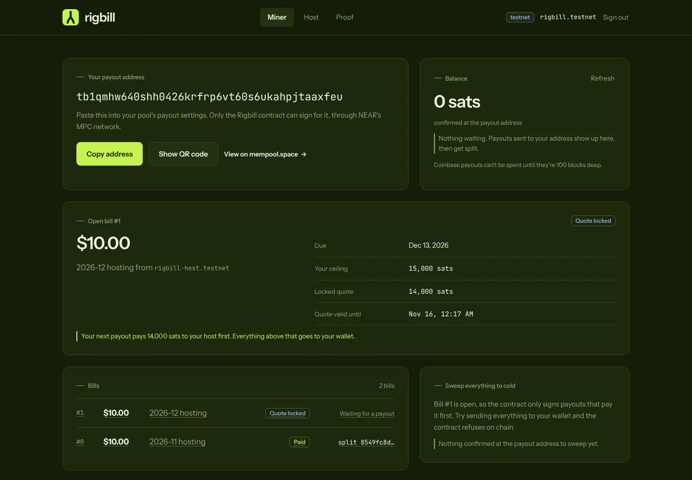

# Rigbill

[](https://github.com/mystiquemide/Rigbill/actions/workflows/ci.yml)

A Bitcoin payout address that can't skip the hosting bill. While a bill is open, nothing leaves it unless it pays the bill first, in USDC, and the rest goes to the miner's own wallet.

Mining hosts run other people's rigs and bill them every month in dollars. The miners earn BTC, so every month someone sells coins by hand, a pool converts them custodially, or the host chases a late payment. Any miner can also move a payout before the bill clears. Rigbill gives each miner a payout address whose only key is a NEAR smart contract, through Chain Signatures. The contract reads every Bitcoin transaction before it signs and refuses any that doesn't pay the open bill through NEAR Intents 1Click.

Here it is refusing: the miner tried to [send everything to cold while a bill was open](https://testnet.nearblocks.io/txns/B78JMiGRV33ntgvKzKoP5RpV45Ufn3u8JbKF4KndcN8J) and the contract failed with `BILL_OPEN_HOST_OUTPUT_REQUIRED` before asking the MPC network for a signature. The next payout [paid the bill and sent the rest to cold](https://mempool.space/testnet4/tx/8549fc8d90d10f02aee8cf3b528259f26962f793837c6bb40ab74ca804b3f27e).


## Who it's for

A hosting company with a few hundred client rigs could start using it tomorrow. It needs no new bank account, exchange account or custodian. The host issues bills in USD and gets USDC on Base, which drops straight into normal accounting. The miner keeps self-custody: the remainder of every payout lands in their own cold wallet, and nobody, Rigbill included, can sign anything else.

## How it works

1. The miner signs in with a NEAR wallet, sets a cold address and a fee cap, and points their pool at the payout address. That address is derived from the contract's account through the NEAR MPC network (`v1.signer`), so no person or server holds its key.
2. The host issues a bill in USD. The miner accepts it with a ceiling in sats, the most the bill may ever cost them.
3. The host locks a 1Click quote that turns BTC into the bill's USDC on Base. The contract refuses any quote above the miner's ceiling.
4. A payout arrives. Anyone can run the relayer, which asks the contract to sign a split. The contract builds the Bitcoin sighash itself and signs only when the outputs are exactly the approved 1Click deposit for the quoted amount, followed by the miner's cold address.
5. 1Click swaps the BTC and delivers USDC to the host. The host marks the bill paid, and later payouts go straight to cold storage.

The rule: nothing leaves the payout address except to the host's approved bill or the miner's cold wallet, and while a bill is open nothing leaves without paying it.

## Why NEAR

Take NEAR out and there's no product left.

- Chain Signatures (`v1.signer`) is the only key the payout address has. The address is derived from the contract's account, so no person or server could ever sign for it.
- The NEAR contract is the policy. It builds the BIP143 sighash for every Bitcoin transaction itself, checks each output against the open bill and the miner's settings, and only then requests the MPC signature.
- NEAR Intents 1Click turns the bill's share of the payout into USDC on Base at a quote the host locks and the miner's ceiling caps.

## Proof

The full loop runs on NEAR testnet and Bitcoin testnet4. Check it yourself with no keys and no setup beyond Node 20+:

```bash
npm run verify
```

It reads the contract and both chains live, then checks that the payout address comes from the MPC key, that each Bitcoin transaction matches what the contract signed output for output, that each refusal failed on chain without ever reaching the signer, and that 1Click returns a live mainnet quote for the USDC leg (a dry quote, nothing is sent).

| What | Link |
|---|---|
| Contract | [v1.rigbill.testnet](https://testnet.nearblocks.io/address/v1.rigbill.testnet) |
| Payout address | [tb1qmhw640shh0426krfrp6vt60s6ukahpjtaaxfeu](https://mempool.space/testnet4/address/tb1qmhw640shh0426krfrp6vt60s6ukahpjtaaxfeu) |
| NEAR tx that requested the MPC signature | [3vhWBY74…](https://testnet.nearblocks.io/txns/3vhWBY74mJ8hUjuXQEmRN6sQh8jQ1WmvVvs5dzrjzrpP) |
| Bitcoin split that paid bill #0 | [8549fc8d…](https://mempool.space/testnet4/tx/8549fc8d90d10f02aee8cf3b528259f26962f793837c6bb40ab74ca804b3f27e): 14,092 sats to the deposit address, 35,578 to cold |
| Host confirms paid | [GTd6xhQ6…](https://testnet.nearblocks.io/txns/GTd6xhQ6kBXMTp8xcmtM3L7W5PvbwcqNkMfEnst7Ew5W) |
| Refused: cold-only sweep while a bill is open | [B78JMiGR…](https://testnet.nearblocks.io/txns/B78JMiGRV33ntgvKzKoP5RpV45Ufn3u8JbKF4KndcN8J) `BILL_OPEN_HOST_OUTPUT_REQUIRED` |
| Refused: a third output | [3m3KTFmS…](https://testnet.nearblocks.io/txns/3m3KTFmSdhyLvfdDWsk68nUaAUPxwbpt6G6HLLKoXUy5) `OUTPUT_NOT_ALLOWED` |
| Refused: spending a payout that was already signed | [6qv2g2Uk…](https://testnet.nearblocks.io/txns/6qv2g2Uk1P6AmE3SdptprKu8kJ8T5UMDxGyGA9GiGUmQ) `OUTPOINT_ALREADY_SIGNED` |

Nearblocks can block automated clients. Any NEAR transaction above can also be read straight from the public RPC:

```bash
curl -s https://rpc.testnet.near.org -H 'content-type: application/json' -d '{"jsonrpc":"2.0","id":1,"method":"tx","params":{"tx_hash":"B78JMiGRV33ntgvKzKoP5RpV45Ufn3u8JbKF4KndcN8J","sender_account_id":"rigbill.testnet","wait_until":"FINAL"}}'
```

The same loop also ran through the web app with fresh accounts (`e2e/`): the miner's sweep to cold was [refused in the UI](https://testnet.nearblocks.io/txns/9MUxwPwg3o3ScCiv79R7ebHhJ5nvz8urHAcMrgARy72Z), then the payout [paid the $6 bill](https://mempool.space/testnet4/tx/b0a874bc798c64d7f513605aaab5e58e021eb4b935f7dce90f161fe17b4ccdd9) and the host confirmed it.

NEAR Intents has no testnet, so on testnet the host's output goes to a stand-in deposit address and there is no USDC leg. The demo payout comes from the miner's own testnet wallet, standing in for a pool.

## Screens

Every screen reads live state from the contract, Bitcoin and NEAR. Nothing is sample data.

| Miner home | Host bill | Live proof |
|---|---|---|
|  |  |  |

| Route | Who | What |
|---|---|---|
| `/` | Anyone | What Rigbill does, with the latest paid bill and the refusals read live |
| `/miner` | Miner | Set up a payout address, see the open bill, accept bills, try a sweep and watch it get refused |
| `/miner/bills/:id` | Miner | Accept a bill with a ceiling, follow it to paid |
| `/host` | Host | Issue bills, see what each one needs next |
| `/host/bills/:id` | Host | Lock a live 1Click quote, confirm paid or report a refund |
| `/proof` | Anyone | The `npm run verify` checks, run in the browser |

Sign in with any NEAR wallet that supports testnet through NEAR Connect, such as Meteor, Intear or Nightly.

## Status

Everything here was written from 2026-11-12. The full loop runs on NEAR testnet and Bitcoin testnet4: MPC signing, the bill lifecycle and every refusal, checked by `npm run verify` and CI on each commit. NEAR Intents has no testnet, so the swap itself is the one part that hasn't run end to end. The code for it follows 1Click's API, and each verify run fetches a live mainnet quote for a $6 bill to show the route is there.

## Run it

Web app (testnet by default, `VITE_NETWORK=mainnet` for mainnet):

```bash
cd web && npm install && npm run dev
```

Relayer:

```bash
cd relayer && npm install
```

```bash
NETWORK=testnet npm run relayer -- address <miner.testnet>
```

```bash
NETWORK=testnet npm run relayer -- split <miner.testnet> --dry-run
```

`--dry-run` builds and prints the split without signing. It needs at least one confirmed payout at the miner's payout address.

```bash
NETWORK=testnet npm run relayer -- status <miner.testnet>
```

`split` without `--dry-run` needs a funded NEAR account in `RELAYER_ACCOUNT_ID` and `RELAYER_PRIVATE_KEY` (see `.env.example`). The relayer has no special rights: it can only submit splits the contract accepts, and it refuses to broadcast unless every MPC signature verifies against the payout key and the contract's sighashes match its own build.

Contract (Rust, near-sdk 5):

```bash
cd contract && cargo test
```

```bash
./build.sh
```

`build.sh` compiles to wasm and shrinks it with Binaryen's `wasm-opt` into `contract/out/rigbill.wasm`.

## Tests

```bash
npm test
```

Runs 64 contract tests (split rules, every refusal, BIP143 sighash vectors, bill lifecycle, quote ceiling and expiry) and 8 relayer tests (transaction parity with the contract, signature checks). CI runs these on every push along with clippy, the web build and `npm run verify` against the live chains.

## Repository

| Path | What |
|---|---|
| `contract/` | NEAR contract: miners, bills, quotes, split rules, BIP143 sighash, outpoint registry, MPC calls |
| `relayer/` | CLI: derive, split, verify signatures, broadcast, 1Click deposit and status, `verify` |
| `web/` | Landing, miner and host screens, live proof page, NEAR Connect sign-in |
| `proof/` | Refusal transactions that `npm run verify` checks |
| `e2e/` | Browser end-to-end test of the web app on testnet |

## Known limits

- The bill is marked paid when the host confirms it. That's safe in one direction: confirming is the host giving up its own claim, so it can't take anything from the miner. A host that never confirms only blocks the miner until the bill expires. Verifying the Base USDC transfer through `v1.signer`'s foreign-chain verification would remove that wait and isn't built yet.
- The contract only tracks payouts it signed. It can't stop a transaction signed elsewhere, but the payout address has no other key, so there is nothing else to sign with.
- A miner can still point their pool at a different address off-chain. Hosts usually control the rigs and can watch each rig's payout address.
- An unpaid bill expires 7 days after its due date, which releases the miner.
- The contract account keeps a full-access key, so its code can be upgraded. No method moves funds outside the split rules.
- 1Click won't swap less than about 8,300 sats, so very small bills can't be paid this way.

## License

MIT
