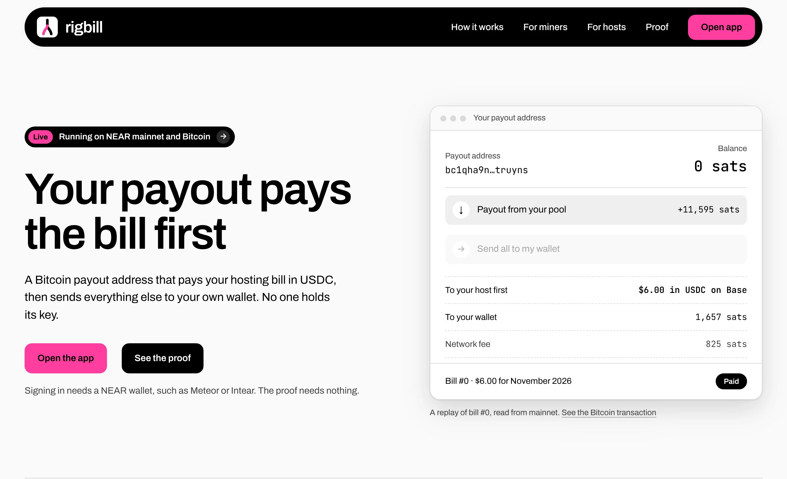
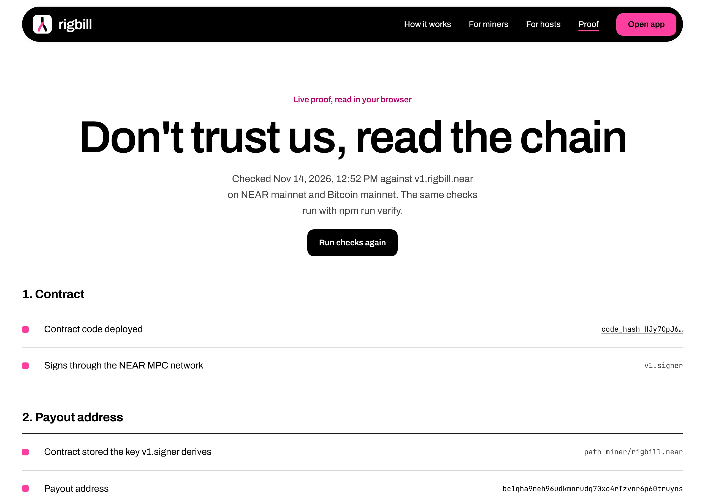

# Rigbill

**Built on [NEAR](https://near.org).** [NEAR Chain Signatures](https://docs.near.org/chain-abstraction/chain-signatures) holds the only key to the Bitcoin payout address, a NEAR contract decides what it may sign, and [NEAR Intents](https://intents.near.org) 1Click pays the host in USDC on Base. Live on NEAR mainnet.

[](https://near.org)
[](https://docs.near.org/chain-abstraction/chain-signatures)
[](https://intents.near.org)
[](https://nearblocks.io/address/v1.rigbill.near)
[](https://github.com/mystiquemide/Rigbill/actions/workflows/ci.yml)

**Live app:** [rigbill.midelabs.xyz](https://rigbill.midelabs.xyz) · **Live proof:** [rigbill.midelabs.xyz/proof](https://rigbill.midelabs.xyz/proof)

A Bitcoin payout address that can't skip the hosting bill. While a bill is open, nothing leaves it unless it pays the bill first, in USDC, and the rest goes to the miner's own wallet.

Mining hosts run other people's rigs and bill them every month in dollars. The miners earn BTC, so every month someone sells coins by hand, a pool converts them custodially, or the host chases a late payment. Any miner can also move a payout before the bill clears. Rigbill gives each miner a payout address whose only key is a NEAR smart contract, through Chain Signatures. The contract reads every Bitcoin transaction before it signs and refuses any that doesn't pay the open bill through NEAR Intents 1Click.

It runs on mainnet with real money. The miner tried to [send everything to cold while a bill was open](https://nearblocks.io/txns/2cTep6qoRqYoLKb6uoSaPFfi1jsRzUvUfuvyrsomn9Ch) and the contract failed with `BILL_OPEN_HOST_OUTPUT_REQUIRED` before asking the MPC network for a signature. The payout then [paid the bill and sent the rest to cold](https://mempool.space/tx/fcdf483e77ceb067b3c120f42c0b2a91a20194d61ed63329ca3c28837b25a397), and 1Click [delivered the USDC on Base](https://basescan.org/tx/0x2c3e7251d5178d0b83006457e06694e1ecf80176e072dcbb80cd931f1950b1c6).




## Who it's for

A hosting company with a few hundred client rigs could start using it tomorrow. It needs no new bank account, exchange account or custodian. The host issues bills in USD and gets USDC on Base, which drops straight into normal accounting. The miner keeps self-custody: the remainder of every payout lands in their own cold wallet, and nobody, Rigbill included, can sign anything else.

## How it works

1. The miner signs in with a NEAR wallet, sets a cold address and a fee cap, and points their pool at the payout address. That address is derived from the contract's account through the NEAR MPC network (`v1.signer`), so no person or server holds its key.
2. The host issues a bill in USD. The miner accepts it with a ceiling in sats, the most the bill may ever cost them.
3. The host locks a 1Click quote that turns BTC into the bill's USDC on Base. The contract refuses any quote above the miner's ceiling.
4. A payout arrives. The relayer, run by the miner, the host or someone the miner approves, asks the contract to sign a split. The contract builds the Bitcoin sighash itself and signs only when the outputs are exactly the approved 1Click deposit for the quoted amount, followed by the miner's cold address.
5. 1Click swaps the BTC and delivers USDC to the host. The host marks the bill paid, and later payouts go straight to cold storage.

The rule: nothing leaves the payout address except to the host's approved bill or the miner's cold wallet, and while a bill is open nothing leaves without paying it.

## Why NEAR

Take NEAR out and there's no product left.

- Chain Signatures (`v1.signer`) is the only key the payout address has. The address is derived from the contract's account, so no person or server could ever sign for it.
- The NEAR contract is the policy. It builds the BIP143 sighash for every Bitcoin transaction itself, checks each output against the open bill and the miner's settings, and only then requests the MPC signature.
- NEAR Intents 1Click turns the bill's share of the payout into USDC on Base at a quote the host locks and the miner's ceiling caps.

### The NEAR stack

| NEAR piece | Where | What Rigbill uses it for |
|---|---|---|
| NEAR smart contract (Rust, `near-sdk` 5.30.1) | [`v1.rigbill.near`](https://nearblocks.io/address/v1.rigbill.near) on mainnet, `v1.rigbill.testnet` on testnet | Holds miners, bills and quotes, builds every Bitcoin sighash itself, enforces the split rules and reserves each payout per miner |
| Chain Signatures | `v1.signer` (`derived_public_key`, `sign`, secp256k1 domain 0) | Derives each miner's Bitcoin payout address from the contract's account and signs only the splits the contract approves. No person or server holds the key |
| NEAR Intents 1Click | `1click.chaindefuser.com` (`quote`, `deposit/submit`, `status`) | Turns the host's share of a payout from BTC into USDC on Base at a locked EXACT_OUTPUT quote, then reports the swap so the host can confirm paid |
| NEAR Connect (`@hot-labs/near-connect` 0.12) | Web app | Wallet sign-in for miners and hosts (Meteor, Intear, Nightly and others) |
| `near-api-js` 7 | Relayer CLI | Sends `sign_split`, reads results and verifies every MPC signature before broadcasting |
| NEAR RPC | FastNEAR, with the official RPC as fallback | Live reads for the app, `/proof` and `npm run verify` |
| NEP-297 events | `EVENT_JSON` logs from the contract | `bill_*`, `split_requested`, `split_result` and `split_released` events for indexers |

## Proof

The full loop runs on NEAR mainnet, Bitcoin mainnet and Base. Check it yourself with no keys and no setup beyond Node 20+:

```bash
npm run verify
```

It reads the contract and all three chains live, then checks that the payout address comes from the MPC key, that each Bitcoin transaction matches what the contract signed output for output, that 1Click delivered the USDC, and that each refusal failed on chain without ever reaching the signer.

| What | Link |
|---|---|
| Contract | [v1.rigbill.near](https://nearblocks.io/address/v1.rigbill.near) |
| Payout address | [bc1qha9neh96udkmnrudq70xc4rfzvnr6p60truyns](https://mempool.space/address/bc1qha9neh96udkmnrudq70xc4rfzvnr6p60truyns) |
| NEAR tx that requested the MPC signature | [5iouTCA3…](https://nearblocks.io/txns/5iouTCA3KtZL5Wkoe45wyd3bPEuZPKPLBFa7JynoreBU) |
| Bitcoin split that paid bill #0 | [fcdf483e…](https://mempool.space/tx/fcdf483e77ceb067b3c120f42c0b2a91a20194d61ed63329ca3c28837b25a397): 9,113 sats to the 1Click deposit, 1,657 to cold |
| USDC delivered on Base | [0x2c3e7251…](https://basescan.org/tx/0x2c3e7251d5178d0b83006457e06694e1ecf80176e072dcbb80cd931f1950b1c6): 6.20 USDC |
| Host confirms paid | [FnW37Rd4…](https://nearblocks.io/txns/FnW37Rd4xu7rY4GG4ovtNmHt484Frep5hZ7dgZ6B6NqG) |
| Refused: cold-only sweep while a bill is open | [2cTep6qo…](https://nearblocks.io/txns/2cTep6qoRqYoLKb6uoSaPFfi1jsRzUvUfuvyrsomn9Ch) `BILL_OPEN_HOST_OUTPUT_REQUIRED` |
| Refused: a third output | [2GJwdkLg…](https://nearblocks.io/txns/2GJwdkLgVbccvwaWEUvArBy4H8jYu2wyxMyqmVoymRFt) `OUTPUT_NOT_ALLOWED` |
| Refused: spending a payout that was already signed | [8gLWfPQx…](https://nearblocks.io/txns/8gLWfPQxHjQxTe4An9AN48mWgRMFv8Ubh8MsQwKY6QGK) `OUTPOINT_ALREADY_SIGNED` |

The bill was $6. 1Click's minimum had risen just above that, so the host locked a quote for 6.20 USDC, still inside the miner's sats ceiling.

Nearblocks can block automated clients. Any NEAR transaction above can also be read straight from the public RPC:

```bash
curl -s https://rpc.mainnet.near.org -H 'content-type: application/json' -d '{"jsonrpc":"2.0","id":1,"method":"tx","params":{"tx_hash":"2cTep6qoRqYoLKb6uoSaPFfi1jsRzUvUfuvyrsomn9Ch","sender_account_id":"1991985a028ec13f6c7794d764ea1494f7acc049059ef8302f50e320059dbc7c","wait_until":"FINAL"}}'
```

The same build ran the loop first on NEAR testnet and Bitcoin testnet4 (`NETWORK=testnet npm run verify`), with a stand-in for the 1Click deposit since Intents has no testnet: [split](https://mempool.space/testnet4/tx/8549fc8d90d10f02aee8cf3b528259f26962f793837c6bb40ab74ca804b3f27e) and refusals [1](https://testnet.nearblocks.io/txns/B78JMiGRV33ntgvKzKoP5RpV45Ufn3u8JbKF4KndcN8J), [2](https://testnet.nearblocks.io/txns/3m3KTFmSdhyLvfdDWsk68nUaAUPxwbpt6G6HLLKoXUy5), [3](https://testnet.nearblocks.io/txns/6qv2g2Uk1P6AmE3SdptprKu8kJ8T5UMDxGyGA9GiGUmQ). On testnet the loop also ran through the web app with fresh accounts (`e2e/`): the miner's sweep to cold was [refused in the UI](https://testnet.nearblocks.io/txns/9MUxwPwg3o3ScCiv79R7ebHhJ5nvz8urHAcMrgARy72Z), then the payout [paid the $6 bill](https://mempool.space/testnet4/tx/b0a874bc798c64d7f513605aaab5e58e021eb4b935f7dce90f161fe17b4ccdd9) and the host confirmed it.

The demo payouts come from the builder's own wallet, standing in for a pool.

## Screens

Every screen reads live state from the contract, Bitcoin and NEAR. Nothing is sample data.

| Miner home | Host bill | Live proof |
|---|---|---|
|  |  |  |

| Route | Who | What |
|---|---|---|
| `/` | Anyone | What Rigbill does, with the latest paid bill and the refusals read live |
| `/miner` | Miner | Set up a payout address, see the open bill, accept bills, try a sweep and watch it get refused, approve up to three relayers, release a signed split that never reached Bitcoin |
| `/miner/bills/:id` | Miner | Accept a bill with a ceiling, follow it to paid |
| `/host` | Host | Issue bills, see what each one needs next |
| `/host/bills/:id` | Host | Lock a live 1Click quote, watch the swap, confirm paid in one click once 1Click reports the USDC delivered (with the Basescan link), or report a refund |
| `/proof` | Anyone | The `npm run verify` checks, run in the browser |

Sign in with any NEAR wallet through NEAR Connect, such as Meteor, Intear or Nightly.

## Status

Everything here was written from 2026-11-12. The whole loop has run on mainnet: MPC signing, the bill lifecycle, a real BTC to USDC swap through 1Click and every refusal. `npm run verify` and CI check both mainnet and testnet on each commit, along with a live 1Click quote to show the route is still open.

## Use it from an agent

An AI agent can run either side of Rigbill without being trusted. The contract decides what can be signed, so a buggy or compromised agent can fail to act but can't move money anywhere the rules don't allow.

**As the miner's relayer.** The repo ships a keeper agent for this. The miner approves the agent's NEAR account under Approved relayers in the app (`set_relayers`), then the agent runs on its own:

```bash
cd relayer && npm run agent -- <miner.near> [more miners] --interval 60
```

Every interval, for each miner, it reads the open bill, skips payouts already reserved in a signed split, and decides: wait (no quote yet, quote expired, fee over the miner's cap, too little to cover the bill), stay idle, or split. To split it asks the contract for MPC signatures (`sign_split`), checks the contract built the same transaction, verifies every signature against the payout key, broadcasts to Bitcoin and hands the deposit to 1Click. While a bill is being paid it reports the 1Click swap, so the host knows when to confirm. It logs one JSON line per decision, and `--dry-run` shows what it would do without sending anything. One miner's error never stops the others. The decision logic is a pure function with its own tests (`relayer/test/decide.test.ts`).

The contract only signs a split that pays the open bill first and sends the rest to the miner's own wallet, so the agent holds no power over anyone's Bitcoin.

**As the host's billing agent.** The agent signs in with the host's account and calls the contract directly:

| Step | Method | Limit the contract enforces |
|---|---|---|
| Bill a miner in USD | `issue_bill` | Due date in the next 90 days, 0.01 NEAR storage deposit |
| Lock a live 1Click quote | `approve_quote` | Never above the miner's sats ceiling, deadline in the future |
| Mark the bill paid once 1Click reports `SUCCESS` | `confirm_paid` | Host only |
| Report a refunded swap | `report_refund` | Host only, the bill goes back to accepted |

`confirm_paid` is still the host's word, whether a person or an agent sends it. See Known limits.

## Run it

Web app (mainnet by default, `VITE_NETWORK=testnet` for testnet):

```bash
cd web && npm install && npm run dev
```

To serve it, the root `Dockerfile` builds the app and serves it with nginx (`--build-arg VITE_NETWORK=testnet` for testnet):

```bash
docker build -t rigbill-web . && docker run -p 8080:80 rigbill-web
```

Relayer:

```bash
cd relayer && npm install
```

```bash
NETWORK=testnet npm run relayer -- address <miner.testnet>
```

```bash
NETWORK=testnet npm run relayer -- split <miner.testnet> --dry-run
```

`--dry-run` builds and prints the split without signing. It needs at least one confirmed payout at the miner's payout address.

```bash
NETWORK=testnet npm run relayer -- status <miner.testnet>
```

`split` without `--dry-run` needs a funded NEAR account in `RELAYER_ACCOUNT_ID` and `RELAYER_PRIVATE_KEY` (see `.env.example`). The relayer has no special rights beyond being allowed to ask: the miner approves it with `set_relayers` (in the app under Approved relayers), it can only submit splits the contract accepts, and it refuses to broadcast unless every MPC signature verifies against the payout key and the contract's sighashes match its own build.

Contract (Rust, near-sdk 5):

```bash
cd contract && cargo test
```

```bash
./build.sh
```

`build.sh` compiles to wasm and shrinks it with Binaryen's `wasm-opt` into `contract/out/rigbill.wasm`. With the pinned toolchain in `rust-toolchain.toml`, the result's base58 SHA-256 is `HJy7CpJ6pjGPfthmnTdiFqe42AgyFtgUCiNmnVWxwNkK`, the code hash deployed on both `v1.rigbill.near` and `v1.rigbill.testnet`. `npm run verify` prints the live hash.

## Tests

`npm run verify` needs only Node. The unit tests also need Rust (the toolchain is pinned in `rust-toolchain.toml`):

```bash
npm test
```

Runs 80 contract tests (split rules, who may request a split, per-miner outpoints, storage cost, releasing an unused split, every refusal, BIP143 sighash vectors, bill lifecycle, quote ceiling and expiry) and 15 relayer tests (transaction parity with the contract, signature checks, the agent's split decisions). CI runs these on every push along with clippy, the web build and `npm run verify` against the live chains.

## Repository

| Path | What |
|---|---|
| `contract/` | NEAR contract: miners, bills, quotes, split rules, BIP143 sighash, outpoint registry, MPC calls |
| `relayer/` | CLI: derive, split, verify signatures, broadcast, 1Click deposit and status, `verify` |
| `web/` | Landing, miner and host screens, live proof page, NEAR Connect sign-in |
| `proof/` | Refusal transactions that `npm run verify` checks |
| `e2e/` | Browser end-to-end test of the web app on testnet |

## Known limits

- The bill is marked paid when the host confirms it. That's safe in one direction: confirming is the host giving up its own claim, so it can't take anything from the miner. A host that never confirms only blocks the miner until the bill expires. Verifying the Base USDC transfer through `v1.signer`'s foreign-chain verification would remove that wait and isn't built yet.
- Input values come from the caller. The contract can't read Bitcoin, so it signs over the values it's given, and a wrong value produces a signature no node will accept. That's why only the miner, the open bill's host or a relayer the miner approved may ask for a split, and why the miner can `release_split` a signed split that was never broadcast (in the app under Release an unused split). Release is refused while the bill's quote is still live.
- The contract only tracks payouts it signed. It can't stop a transaction signed elsewhere, but the payout address has no other key, so there is nothing else to sign with.
- A miner can still point their pool at a different address off-chain. Hosts usually control the rigs and can watch each rig's payout address.
- A bill that isn't paid expires 7 days after its due date, which releases the miner. A due date can be at most 90 days out. Expiry is applied lazily: views report it at once, but the `bill_expired` event is only logged when a call settles it (anyone can call `expire_bill`). A swap that lands after expiry can still be confirmed paid.
- Payout reservations written before the per-miner fix are no longer read. The only one on mainnet belongs to the bill #0 split, whose coins are spent.
- The contract can't check that the host's deposit address belongs to 1Click. It holds the host to the quote they locked, and the miner's ceiling caps what any quote can take.
- Each split pays for the storage it writes (up to about 0.03 NEAR for four inputs) and gets the rest back.
- The contract account keeps a full-access key, so its code can be upgraded. No method moves funds outside the split rules.
- 1Click has a minimum swap, a little over $6 of USDC when this ran, so very small bills can't be paid this way.

## License

MIT
