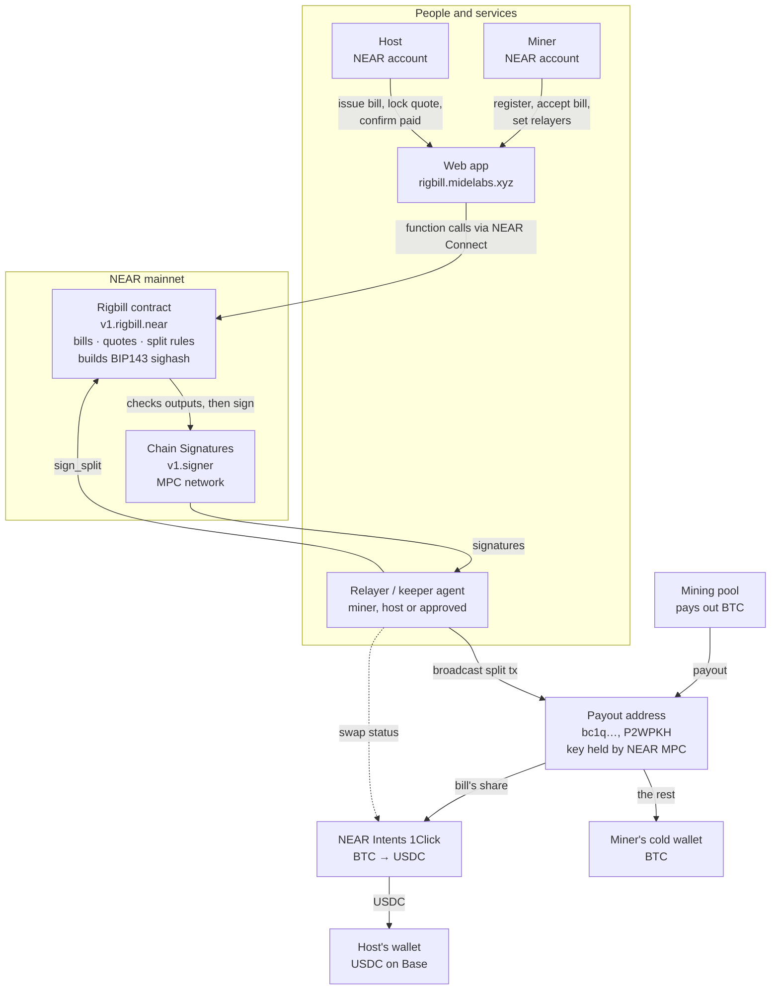
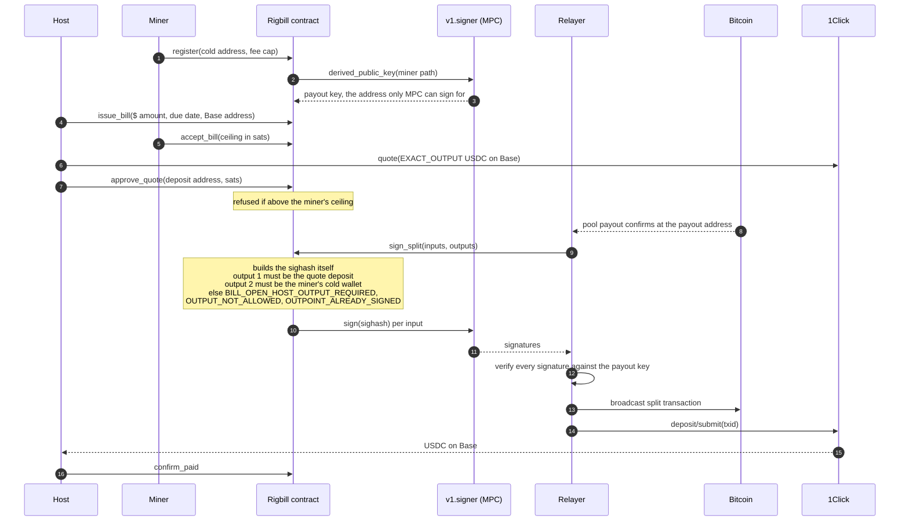
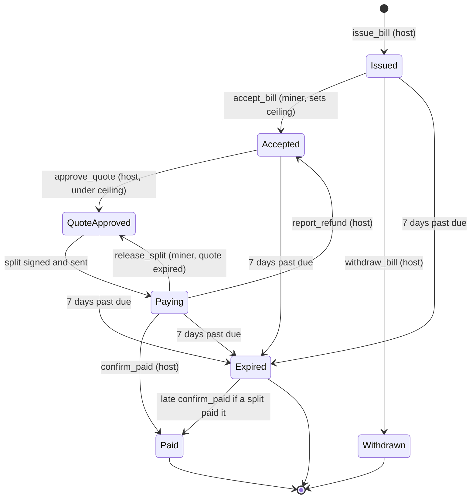
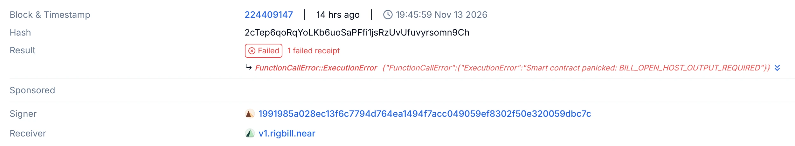
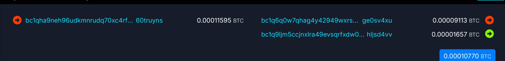
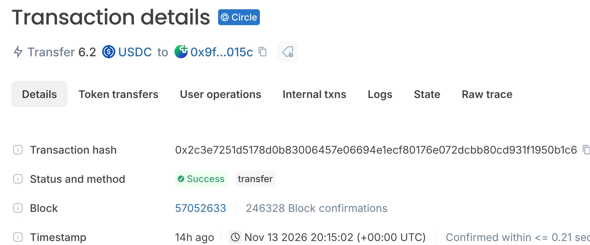

# Rigbill

A Bitcoin payout address that pays the hosting bill first. The host gets USDC on Base, the miner gets the rest in their own wallet, and nobody holds the key: a NEAR contract signs through NEAR Chain Signatures, and NEAR Intents does the swap.

Built at NEAR HACKATHON · #NEARHackathon · [@NEARProtocol](https://x.com/NEARProtocol)

[](https://near.org)
[](https://docs.near.org/chain-abstraction/chain-signatures)
[](https://intents.near.org)
[](https://nearblocks.io/address/v1.rigbill.near)
[](https://github.com/mystiquemide/Rigbill/actions/workflows/ci.yml)
[](LICENSE)

| | |
|---|---|
| Live app | [rigbill.midelabs.xyz](https://rigbill.midelabs.xyz) (NEAR mainnet) |
| Live proof | [rigbill.midelabs.xyz/proof](https://rigbill.midelabs.xyz/proof) |
| Contract | [`v1.rigbill.near`](https://nearblocks.io/address/v1.rigbill.near) on mainnet, `v1.rigbill.testnet` on testnet |
| Judging guide | [JUDGE.md](JUDGE.md): a 5 minute path through the product and the proof |
| Tracks | Real-World Money (`realworld`), Open Innovation (`open`) |

## Contents

- [The problem](#the-problem)
- [The solution](#the-solution)
- [Judge path](#judge-path)
- [Tracks](#tracks)
- [Why NEAR is load bearing](#why-near-is-load-bearing)
- [Architecture](#architecture)
- [Proof on mainnet](#proof-on-mainnet)
- [Screens](#screens)
- [Features](#features)
- [Use it from an agent](#use-it-from-an-agent)
- [What we built and what we used](#what-we-built-and-what-we-used)
- [Built with](#built-with)
- [Run it](#run-it)
- [Tests](#tests)
- [Repository](#repository)
- [Known limits](#known-limits)
- [What's next](#whats-next)
- [About](#about)
- [Hackathon disclosures](#hackathon-disclosures)

## The problem

Bitcoin mining hosts run other people's rigs in their facilities and bill them every month in dollars, for power and space. The miners earn in BTC. That mismatch costs everyone:

- Someone has to sell BTC by hand every month, or let a pool convert payouts custodially.
- The host chases late payments, and has no way to stop a miner moving a payout before the bill clears.
- The miner has to trust whoever does the conversion with their coins.

Today the only fixes are trust: a custodian, an escrow company, or the host holding the miner's keys.

## The solution

Rigbill gives each miner a Bitcoin payout address whose only key is a NEAR smart contract, through Chain Signatures. The miner points their pool at it. While a bill is open, the contract refuses to sign any Bitcoin transaction that doesn't pay that bill first. The bill's share goes to a NEAR Intents 1Click deposit that turns it into USDC on Base for the host, and the rest goes to the miner's own cold wallet.

The rule the contract enforces: nothing leaves the payout address except to the host's approved bill or the miner's cold wallet, and while a bill is open nothing leaves without paying it.

- The host issues bills in USD and gets USDC on Base, which drops straight into normal accounting. No bank account, exchange account or custodian.
- The miner keeps self-custody. The remainder of every payout lands in their own wallet, and nobody, Rigbill included, can sign anything else.
- A hosting company with a few hundred client rigs could start using it tomorrow.

It runs on mainnet with real money. Bill #0 was paid from a real Bitcoin payout: 9,113 sats to the 1Click deposit, 1,657 sats to the miner's wallet, and 6.20 USDC delivered on Base. Before that, the miner tried to send everything to their own wallet and the contract refused on chain with `BILL_OPEN_HOST_OUTPUT_REQUIRED`, before any signature existed.


*The landing page on mainnet. The payout card replays bill #0 from live contract and Bitcoin data, not sample numbers.*

## Judge path

Each step is "do X, see Y". The full version, with what each step proves, is in [JUDGE.md](JUDGE.md).

1. Open [rigbill.midelabs.xyz/proof](https://rigbill.midelabs.xyz/proof). See every check pass, read live from NEAR mainnet, Bitcoin mainnet and 1Click in your browser.
2. Run `npm run verify` from a clone (Node 20+, no keys). See every check print `PASS` in the terminal, ending with `All checks passed.`
3. Open the [refused NEAR transaction](https://nearblocks.io/txns/2cTep6qoRqYoLKb6uoSaPFfi1jsRzUvUfuvyrsomn9Ch). See `Smart contract panicked: BILL_OPEN_HOST_OUTPUT_REQUIRED`: the miner tried to take everything while a bill was open.
4. Open the [Bitcoin split](https://mempool.space/tx/fcdf483e77ceb067b3c120f42c0b2a91a20194d61ed63329ca3c28837b25a397). See two outputs: 9,113 sats to the 1Click deposit, 1,657 sats to the miner's wallet.
5. Open the [USDC transfer on Base](https://basescan.org/tx/0x2c3e7251d5178d0b83006457e06694e1ecf80176e072dcbb80cd931f1950b1c6). See 6.20 USDC delivered to the host.
6. Run `cd contract && cargo test`. See 85 tests pass, including every refusal and the official BIP143 sighash vector.
7. Sign in at [rigbill.midelabs.xyz](https://rigbill.midelabs.xyz) with any NEAR wallet. See your own payout address, derived for your account by the NEAR MPC network.

## Tracks

| Track | Why Rigbill fits |
|---|---|
| Real-World Money (`realworld`), primary | Invoicing and stablecoin settlement for a real business. A mining host bills in USD and gets USDC on Base from its clients' Bitcoin payouts, with no custodian. Uses the track's hints directly: stablecoins (USDC) and NEAR Intents |
| Open Innovation (`open`) | A Bitcoin address governed by a NEAR contract is chain abstraction used as a policy engine for another chain's money: the contract reads every Bitcoin transaction before it lets the MPC network sign |

## Why NEAR is load bearing

Take NEAR out and there's no product left. Each piece below does a job nothing else in the stack can do.

| Remove this | And this breaks |
|---|---|
| Chain Signatures (`v1.signer`) | The payout address has no key. Without MPC signing, someone would have to hold a Bitcoin private key, and that person could skip the bill |
| The NEAR contract | Nothing decides what may be signed. The contract builds the BIP143 sighash for every Bitcoin transaction itself, checks each output against the open bill and the miner's settings, and only then asks the MPC network to sign |
| NEAR Intents 1Click | The host gets BTC instead of dollars, and someone has to sell it by hand. 1Click turns the bill's share into USDC on Base at a quote the host locks and the miner's ceiling caps |
| NEAR accounts and NEAR Connect | Miners and hosts have no identity to bill against or sign in with. Each miner's payout address is derived from their NEAR account |

### The NEAR stack

| NEAR piece | Where | What Rigbill uses it for |
|---|---|---|
| NEAR smart contract (Rust, `near-sdk` 5.30.1) | [`v1.rigbill.near`](https://nearblocks.io/address/v1.rigbill.near) on mainnet, `v1.rigbill.testnet` on testnet | Holds miners, bills and quotes, builds every Bitcoin sighash itself, enforces the split rules and reserves each payout per miner |
| Chain Signatures | `v1.signer` (`derived_public_key`, `sign`, secp256k1 domain 0) | Derives each miner's Bitcoin payout address from the contract's account and signs only the splits the contract approves. No person or server holds the key |
| NEAR Intents 1Click | `1click.chaindefuser.com` (`quote`, `deposit/submit`, `status`) | Turns the host's share of a payout from BTC into USDC on Base at a locked EXACT_OUTPUT quote, then reports the swap so the host can confirm paid |
| NEAR Connect (`@hot-labs/near-connect` 0.12) | Web app | Wallet sign-in for miners and hosts (Meteor, Intear, Nightly and others) |
| `near-api-js` 7 | Relayer CLI and keeper agent | Sends `sign_split`, reads results and verifies every MPC signature before broadcasting |
| NEAR RPC | FastNEAR, with the official RPC as fallback | Live reads for the app, `/proof` and `npm run verify` |
| NEP-297 events | `EVENT_JSON` logs from the contract | `bill_*`, `split_requested`, `split_result` and `split_released` events for indexers |

## Architecture



One payout, from pool to USDC:



The bill lifecycle the contract enforces:



## Proof on mainnet

The full loop ran on NEAR mainnet, Bitcoin mainnet and Base with real money. Check it yourself with no keys and no setup beyond Node 20+:

```bash
npm run verify
```

It reads the contract and all three chains live, then checks that the payout address comes from the MPC key, that each Bitcoin transaction matches what the contract signed output for output, that 1Click delivered the USDC, and that each refusal failed on chain without ever reaching the signer.

| What | Link |
|---|---|
| Contract | [v1.rigbill.near](https://nearblocks.io/address/v1.rigbill.near), code hash `HJy7CpJ6pjGPfthmnTdiFqe42AgyFtgUCiNmnVWxwNkK` |
| Payout address | [bc1qha9neh96udkmnrudq70xc4rfzvnr6p60truyns](https://mempool.space/address/bc1qha9neh96udkmnrudq70xc4rfzvnr6p60truyns) |
| NEAR tx that requested the MPC signature | [5iouTCA3…](https://nearblocks.io/txns/5iouTCA3KtZL5Wkoe45wyd3bPEuZPKPLBFa7JynoreBU) |
| Bitcoin split that paid bill #0 | [fcdf483e…](https://mempool.space/tx/fcdf483e77ceb067b3c120f42c0b2a91a20194d61ed63329ca3c28837b25a397): 9,113 sats to the 1Click deposit, 1,657 to cold, block 975,706 |
| USDC delivered on Base | [0x2c3e7251…](https://basescan.org/tx/0x2c3e7251d5178d0b83006457e06694e1ecf80176e072dcbb80cd931f1950b1c6): 6.20 USDC |
| Host confirms paid | [FnW37Rd4…](https://nearblocks.io/txns/FnW37Rd4xu7rY4GG4ovtNmHt484Frep5hZ7dgZ6B6NqG) |
| Refused: cold-only sweep while a bill is open | [2cTep6qo…](https://nearblocks.io/txns/2cTep6qoRqYoLKb6uoSaPFfi1jsRzUvUfuvyrsomn9Ch) `BILL_OPEN_HOST_OUTPUT_REQUIRED` |
| Refused: a third output | [2GJwdkLg…](https://nearblocks.io/txns/2GJwdkLgVbccvwaWEUvArBy4H8jYu2wyxMyqmVoymRFt) `OUTPUT_NOT_ALLOWED` |
| Refused: spending a payout that was already signed | [8gLWfPQx…](https://nearblocks.io/txns/8gLWfPQxHjQxTe4An9AN48mWgRMFv8Ubh8MsQwKY6QGK) `OUTPOINT_ALREADY_SIGNED` |



*The refusal on NEAR mainnet. The miner asked the contract to send the whole payout to their own wallet while bill #0 was open, and the contract panicked before calling the MPC signer.*



*The split the contract did sign: the bill's share to the 1Click deposit first, the rest to the miner's cold wallet. Nothing else.*



*1Click delivered 6.20 USDC to the host on Base.*

The bill was $6. 1Click's minimum had risen just above that, so the host locked a quote for 6.20 USDC, still inside the miner's sats ceiling. The demo payouts come from the builder's own wallet, standing in for a pool.

Nearblocks can block automated clients. Any NEAR transaction above can also be read straight from the public RPC:

```bash
curl -s https://rpc.mainnet.near.org -H 'content-type: application/json' -d '{"jsonrpc":"2.0","id":1,"method":"tx","params":{"tx_hash":"2cTep6qoRqYoLKb6uoSaPFfi1jsRzUvUfuvyrsomn9Ch","sender_account_id":"1991985a028ec13f6c7794d764ea1494f7acc049059ef8302f50e320059dbc7c","wait_until":"FINAL"}}'
```

The same build ran the loop first on NEAR testnet and Bitcoin testnet4 (`NETWORK=testnet npm run verify`), with a stand-in for the 1Click deposit since Intents has no testnet: [split](https://mempool.space/testnet4/tx/8549fc8d90d10f02aee8cf3b528259f26962f793837c6bb40ab74ca804b3f27e) and refusals [1](https://testnet.nearblocks.io/txns/B78JMiGRV33ntgvKzKoP5RpV45Ufn3u8JbKF4KndcN8J), [2](https://testnet.nearblocks.io/txns/3m3KTFmSdhyLvfdDWsk68nUaAUPxwbpt6G6HLLKoXUy5), [3](https://testnet.nearblocks.io/txns/6qv2g2Uk1P6AmE3SdptprKu8kJ8T5UMDxGyGA9GiGUmQ). On testnet the loop also ran through the web app with fresh accounts (`e2e/`): the miner's sweep to cold was [refused in the UI](https://testnet.nearblocks.io/txns/9MUxwPwg3o3ScCiv79R7ebHhJ5nvz8urHAcMrgARy72Z), then the payout [paid the $6 bill](https://mempool.space/testnet4/tx/b0a874bc798c64d7f513605aaab5e58e021eb4b935f7dce90f161fe17b4ccdd9) and the host confirmed it.

## Screens

Every screen reads live state from the contract, Bitcoin and NEAR. Nothing is sample data. The proof and landing pages are on mainnet; the miner and host screens are from the testnet app, signed in as `rigbill.testnet` and `rigbill-host.testnet`.

### Miner home


The miner's whole picture on one screen: the payout address to paste into the pool, what's waiting there, the open bill and exactly what the next payout will pay. The "Send everything to my wallet" panel lets the miner try to skip the bill and watch the contract refuse it on chain.

### Miner controls: settings, approved relayers, release a split


The miner sets their cold wallet and fee cap, approves up to three relayer accounts (such as the keeper agent) that may ask the contract for splits, and can release a split that was signed but never reached Bitcoin. The app checks the chain first and refuses to release a split that's already on Bitcoin.

### Host: issue bills


The host bills a miner in US dollars and names the Base address where USDC should land. Each bill shows its state and what it's waiting for next.

### Host: one bill, paid


Every step of the bill, from issue to paid, with the Bitcoin transaction that paid it. On mainnet this screen also follows the 1Click swap and enables Confirm paid in one click once 1Click reports the USDC delivered, with the Basescan link.

### Live proof


![Proof page, sections 3 and 4. Bills and the Bitcoin transactions that paid them: split #0 signed by the MPC network, every input spends the payout address, outputs on chain are exactly what the contract signed (9,113 + 1,657 sats), first output is the approved quote, 1Click swapped it and delivered USDC on Base (SUCCESS), confirmed on Bitcoin block 975,706. Refusals: send everything to cold while bill 0 is open, BILL_OPEN_HOST_OUTPUT_REQUIRED. Add a third output, OUTPUT_NOT_ALLOWED. Spend a payout that split 0 already signed, OUTPOINT_ALREADY_SIGNED.](docs/screens/proof-bill.webp)

The same checks as `npm run verify`, run in the visitor's browser against NEAR mainnet, Bitcoin mainnet and 1Click. Any judge can rerun them with one click.

### Routes

| Route | Who | What |
|---|---|---|
| `/` | Anyone | What Rigbill does, with the latest paid bill and the refusals read live |
| `/miner` | Miner | Set up a payout address, see the open bill, accept bills, try a sweep and watch it get refused, approve up to three relayers, release a signed split that never reached Bitcoin |
| `/miner/bills/:id` | Miner | Accept a bill with a ceiling, follow it to paid |
| `/host` | Host | Issue bills, see what each one needs next |
| `/host/bills/:id` | Host | Lock a live 1Click quote, watch the swap, confirm paid in one click once 1Click reports the USDC delivered, or report a refund |
| `/proof` | Anyone | The `npm run verify` checks, run in the browser |

Sign in with any NEAR wallet through NEAR Connect, such as Meteor, Intear or Nightly.

## Features

| Feature | Who | Enforced by |
|---|---|---|
| Payout address with no private key, derived per miner | Miner | Chain Signatures `derived_public_key` |
| Bills in USD with a due date and a Base address for USDC | Host | Contract, 0.01 NEAR storage deposit, due date at most 90 days out |
| Accept a bill with a ceiling in sats, the most it may ever cost | Miner | Contract refuses any quote above it (`QUOTE_OVER_CEILING`) |
| Lock a live 1Click quote | Host | Contract, quote deadline must be in the future |
| Split: bill first, the rest to the miner's cold wallet | Relayer | Contract builds the sighash and checks every output before MPC signs |
| Refusals on chain | Anyone | `BILL_OPEN_HOST_OUTPUT_REQUIRED`, `OUTPUT_NOT_ALLOWED`, `OUTPOINT_ALREADY_SIGNED`, fee over the miner's cap |
| Approved relayers, up to three | Miner | `set_relayers` |
| Release an unused signed split | Miner | `release_split`, refused while the quote is live |
| One-click confirm paid once 1Click reports delivery | Host | `confirm_paid` |
| Report a refunded swap | Host | `report_refund`, the bill goes back to accepted |
| Bills expire 7 days after due, releasing the miner | Anyone | Contract, `expire_bill` |
| Keeper agent that splits payouts on its own | Miner or host | Same contract rules, it holds no keys |
| Live proof page and `npm run verify` | Anyone | Reads all three chains, no keys |
| NEP-297 events for indexers | Anyone | `EVENT_JSON` logs |

## Use it from an agent

An AI agent can run either side of Rigbill without being trusted. The contract decides what can be signed, so a buggy or compromised agent can fail to act but can't move money anywhere the rules don't allow.

As the miner's relayer, the repo ships a keeper agent. The miner approves the agent's NEAR account under Approved relayers in the app (`set_relayers`), then the agent runs on its own:

```bash
cd relayer && npm run agent -- <miner.near> [more miners] --interval 60
```

Every interval, for each miner, it reads the open bill, skips payouts already reserved in a signed split, and decides: wait (no quote yet, quote expired, fee over the miner's cap, too little to cover the bill), stay idle, or split. To split it asks the contract for MPC signatures (`sign_split`), checks the contract built the same transaction, verifies every signature against the payout key, broadcasts to Bitcoin and hands the deposit to 1Click. While a bill is being paid it reports the 1Click swap, so the host knows when to confirm. It logs one JSON line per decision, and `--dry-run` shows what it would do without sending anything. A real dry run against mainnet:

```text
{"t":"2026-11-14T09:57:45.605Z","network":"mainnet","miner":"-","event":"start","miners":["rigbill.near"],"intervalS":60,"dryRun":true,"contract":"v1.rigbill.near","relayer":"1991985a028ec13f6c7794d764ea1494f7acc049059ef8302f50e320059dbc7c"}
{"t":"2026-11-14T09:57:46.476Z","network":"mainnet","miner":"rigbill.near","event":"idle","address":"bc1qha9neh96udkmnrudq70xc4rfzvnr6p60truyns","reason":"nothing confirmed at the payout address"}
```

One miner's error never stops the others. The decision logic is a pure function with its own tests (`relayer/test/decide.test.ts`).

As the host's billing agent, the agent signs in with the host's account and calls the contract directly:

| Step | Method | Limit the contract enforces |
|---|---|---|
| Bill a miner in USD | `issue_bill` | Due date in the next 90 days, 0.01 NEAR storage deposit |
| Lock a live 1Click quote | `approve_quote` | Never above the miner's sats ceiling, deadline in the future |
| Mark the bill paid once 1Click reports `SUCCESS` | `confirm_paid` | Host only |
| Report a refunded swap | `report_refund` | Host only, the bill goes back to accepted |

## What we built and what we used

Everything in this repository was written during the hackathon, starting 2026-11-12. The first commit is the project plan.

| We built | Details |
|---|---|
| NEAR contract | Miners, bills, quotes, split rules, a BIP143 sighash builder in Rust checked against the official test vector, a per-miner outpoint registry, the MPC sign calls and callbacks, storage accounting with refunds, NEP-297 events |
| Relayer CLI | Derives the payout address independently, builds the split, checks it against the contract's sighashes, verifies every MPC signature, broadcasts, submits the 1Click deposit and tracks its status |
| Keeper agent | Runs the relayer on its own for any number of miners, with a pure, tested decision function |
| `npm run verify` | A keyless check of every claim against NEAR, Bitcoin and 1Click |
| Web app | Landing page, miner and host screens, live proof page, NEAR Connect sign-in, an explicit state machine for every read |
| End-to-end test | Browser test of the full loop on testnet with fresh accounts |
| Hosting | Docker image with nginx and security headers, deployed on our own server |

| We used | For |
|---|---|
| NEAR Chain Signatures (`v1.signer`) | The only key to every payout address |
| NEAR Intents 1Click | BTC to USDC on Base |
| NEAR Connect, `near-api-js` | Sign-in and contract calls |
| mempool.space and Blockstream Esplora APIs | Reading and broadcasting Bitcoin transactions |
| FastNEAR and the official NEAR RPC | Reading NEAR |

## Built with

| Layer | Tools |
|---|---|
| Contract | Rust, `near-sdk` 5.30.1, `bech32` 0.11, Binaryen `wasm-opt`, toolchain pinned in `rust-toolchain.toml` |
| NEAR | Chain Signatures (`v1.signer`), NEAR Intents 1Click, NEAR Connect (`@hot-labs/near-connect` 0.12), `near-api-js` 7, FastNEAR RPC, NEP-297 events |
| Bitcoin | `@scure/btc-signer`, `@noble/curves`, `@noble/hashes`, `@scure/base`, P2WPKH with BIP143 sighash |
| Web | React 19, TypeScript, Vite, `qrcode`, Archivo and JetBrains Mono via Fontsource |
| Relayer and agent | Node 20+, TypeScript, `tsx`, Node's built-in test runner |
| Testing | `cargo test`, `node --test`, Playwright for the browser end-to-end test |
| CI and hosting | GitHub Actions, Docker, nginx, Dokploy |
| Chains | NEAR mainnet and testnet, Bitcoin mainnet and testnet4, Base |

## Run it

Web app (mainnet by default, `VITE_NETWORK=testnet` for testnet):

```bash
cd web && npm install && npm run dev
```

To serve it, the root `Dockerfile` builds the app and serves it with nginx (`--build-arg VITE_NETWORK=testnet` for testnet):

```bash
docker build -t rigbill-web . && docker run -p 8080:80 rigbill-web
```

Relayer:

```bash
cd relayer && npm install
```

```bash
NETWORK=testnet npm run relayer -- address <miner.testnet>
```

```bash
NETWORK=testnet npm run relayer -- split <miner.testnet> --dry-run
```

`--dry-run` builds and prints the split without signing. It needs at least one confirmed payout at the miner's payout address.

```bash
NETWORK=testnet npm run relayer -- status <miner.testnet>
```

`split` without `--dry-run` needs a funded NEAR account in `RELAYER_ACCOUNT_ID` and `RELAYER_PRIVATE_KEY` (see `.env.example`). The relayer has no special rights beyond being allowed to ask: the miner approves it with `set_relayers`, it can only submit splits the contract accepts, and it refuses to broadcast unless every MPC signature verifies against the payout key and the contract's sighashes match its own build.

Contract:

```bash
cd contract && cargo test
```

```bash
./build.sh
```

`build.sh` compiles to wasm and shrinks it with `wasm-opt` into `contract/out/rigbill.wasm`. With the pinned toolchain, the result's base58 SHA-256 is `HJy7CpJ6pjGPfthmnTdiFqe42AgyFtgUCiNmnVWxwNkK`, the code hash deployed on both `v1.rigbill.near` and `v1.rigbill.testnet`. `npm run verify` prints the live hash.

## Tests

```bash
npm test
```

Runs 85 contract tests (split rules, who may request a split, per-miner outpoints, storage cost, releasing an unused split, every refusal, BIP143 sighash vectors, the bill lifecycle, quote ceiling and expiry) and 15 relayer tests (transaction parity with the contract, signature checks, the agent's decisions). CI runs these on every push along with clippy, the web build and `npm run verify` against the live chains, including a live 1Click quote to show the route is still open.

## Repository

| Path | What |
|---|---|
| `contract/` | NEAR contract: miners, bills, quotes, split rules, BIP143 sighash, outpoint registry, MPC calls |
| `relayer/` | CLI and keeper agent: derive, split, verify signatures, broadcast, 1Click deposit and status, `verify` |
| `web/` | Landing, miner and host screens, live proof page, NEAR Connect sign-in |
| `proof/` | Refusal transactions that `npm run verify` checks |
| `e2e/` | Browser end-to-end test of the web app on testnet |
| `docs/screens/` | The screenshots in this README |

## Known limits

- The bill is marked paid when the host confirms it. That's safe in one direction: confirming is the host giving up its own claim, so it can't take anything from the miner. A host that never confirms only blocks the miner until the bill expires.
- Input values come from the caller. The contract can't read Bitcoin, so it signs over the values it's given, and a wrong value produces a signature no node will accept. That's why only the miner, the open bill's host or a relayer the miner approved may ask for a split, and why the miner can release a signed split that was never broadcast.
- The contract only tracks payouts it signed. The payout address has no other key, so there is nothing else to sign with.
- A miner can still point their pool at a different address off-chain. Hosts usually control the rigs and can watch each rig's payout address.
- Expiry is applied lazily: views report it at once, but the `bill_expired` event is only logged when a call settles it (anyone can call `expire_bill`).
- The contract can't check that the host's deposit address belongs to 1Click. It holds the host to the quote they locked, and the miner's ceiling caps what any quote can take.
- Each split pays for the storage it writes (up to about 0.03 NEAR for four inputs) and gets the rest back.
- The contract account keeps a full-access key, so its code can be upgraded. No method moves funds outside the split rules.
- 1Click has a minimum swap, a little over $6 of USDC when this ran, so very small bills can't be paid this way.

## What's next

1. Paid, verified on chain. Have the contract check the Base USDC transfer itself through `v1.signer`'s foreign-chain verification, so a bill flips to Paid without the host's word.
2. More payout chains. Let hosts take USDC or USDT on any chain 1Click reaches, not only Base.
3. First hosting partner. Run Rigbill with one real hosting floor and its client rigs, starting with a few miners and monthly bills.
4. Locked upgrades. Remove the contract's full-access key, or hand it to a multisig, once the rules are final.
5. More than one bill at once, partial payments and fee bumping (RBF) for stuck splits.

## About

Rigbill is built by [MystiqueMide](https://github.com/mystiquemide), a solo builder, for NEAR HACKATHON (2026-11-01 to 2026-11-14). It started from a plain question: why does a mining host still chase its clients for dollars when their rigs earn money every day? A payout address that can't skip the bill answers that without anyone holding the miner's coins, and NEAR is the only stack where a contract can hold a Bitcoin key and turn BTC into dollars in one flow.

- Live app: [rigbill.midelabs.xyz](https://rigbill.midelabs.xyz)
- Demo post: on X with #NEARHackathon, tagging [@NEARProtocol](https://x.com/NEARProtocol)
- Contact: open an issue on this repository

## Hackathon disclosures

- Event: NEAR HACKATHON, development window 2026-11-01 to 2026-11-14.
- All code in this repository was written during the window, from 2026-11-12. There is no pre-hackathon baseline and no earlier product on another chain.
- Libraries are listed under [Built with](#built-with). No templates or boilerplate were used. Parts of the code were written with AI coding assistants.
- License: [MIT](LICENSE).

#NEARHackathon
