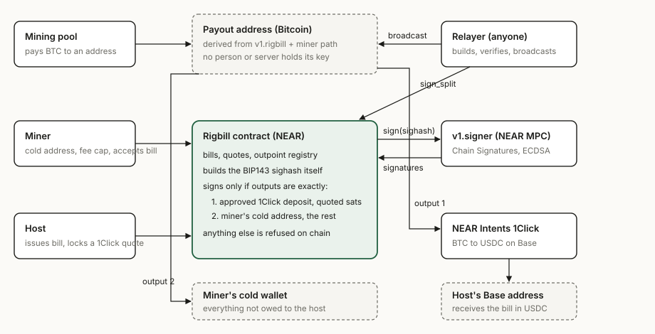
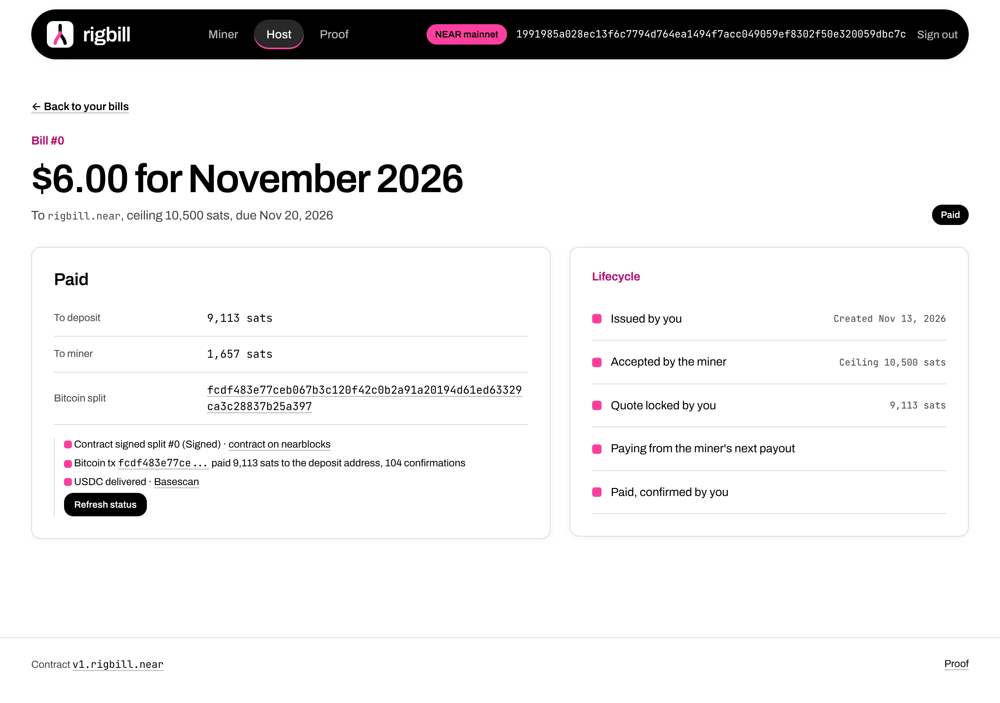

# Rigbill

[](https://github.com/mystiquemide/Rigbill/actions/workflows/ci.yml)

A Bitcoin payout address that pays the miner's hosting bill in USDC first and sends the rest to cold storage, with no company holding the keys.

Miners earn BTC but pay hosting in dollars. Today the only automatic conversion is custodial: a pool converts your balance for you, or you sell by hand every month. Rigbill gives each miner a payout address that a NEAR smart contract controls through Chain Signatures. While the host's bill is open, the contract will only sign a Bitcoin transaction that pays that bill through NEAR Intents, with the remainder going to the miner's own wallet.




## How it works

1. The miner signs in with a NEAR wallet, sets a cold address and a fee cap, and points their pool at the payout address. That address is derived from the contract's account through the NEAR MPC network (`v1.signer`), so no person or server holds its key.
2. The host issues a bill in USD. The miner accepts it with a ceiling in sats, the most the bill may ever cost them.
3. The host locks a 1Click quote that turns BTC into the bill's USDC on Base. The contract refuses any quote above the miner's ceiling.
4. A payout arrives. Anyone can run the relayer, which asks the contract to sign a split. The contract builds the Bitcoin sighash itself and signs only when the outputs are exactly the approved 1Click deposit for the quoted amount, followed by the miner's cold address.
5. 1Click swaps the BTC and delivers USDC to the host. The host marks the bill paid, and later payouts go straight to cold storage.

The rule: nothing leaves the payout address except to the host's approved bill or the miner's cold wallet, and while a bill is open nothing leaves without paying it.

## Proof

The full loop runs on NEAR testnet and Bitcoin testnet4. Check it yourself with no keys and no setup beyond Node 20+:

```bash
npm run verify
```

It reads the contract and both chains live, then checks that the payout address comes from the MPC key, that each Bitcoin transaction matches what the contract signed output for output, and that each refusal failed on chain without ever reaching the signer.

| What | Link |
|---|---|
| Contract | [v1.rigbill.testnet](https://testnet.nearblocks.io/address/v1.rigbill.testnet) |
| Payout address | [tb1qmhw640shh0426krfrp6vt60s6ukahpjtaaxfeu](https://mempool.space/testnet4/address/tb1qmhw640shh0426krfrp6vt60s6ukahpjtaaxfeu) |
| NEAR tx that requested the MPC signature | [3vhWBY74…](https://testnet.nearblocks.io/txns/3vhWBY74mJ8hUjuXQEmRN6sQh8jQ1WmvVvs5dzrjzrpP) |
| Bitcoin split that paid bill #0 | [8549fc8d…](https://mempool.space/testnet4/tx/8549fc8d90d10f02aee8cf3b528259f26962f793837c6bb40ab74ca804b3f27e): 14,092 sats to the deposit address, 35,578 to cold |
| Host confirms paid | [GTd6xhQ6…](https://testnet.nearblocks.io/txns/GTd6xhQ6kBXMTp8xcmtM3L7W5PvbwcqNkMfEnst7Ew5W) |
| Refused: cold-only sweep while a bill is open | [B78JMiGR…](https://testnet.nearblocks.io/txns/B78JMiGRV33ntgvKzKoP5RpV45Ufn3u8JbKF4KndcN8J) `BILL_OPEN_HOST_OUTPUT_REQUIRED` |
| Refused: a third output | [3m3KTFmS…](https://testnet.nearblocks.io/txns/3m3KTFmSdhyLvfdDWsk68nUaAUPxwbpt6G6HLLKoXUy5) `OUTPUT_NOT_ALLOWED` |
| Refused: spending a payout that was already signed | [6qv2g2Uk…](https://testnet.nearblocks.io/txns/6qv2g2Uk1P6AmE3SdptprKu8kJ8T5UMDxGyGA9GiGUmQ) `OUTPOINT_ALREADY_SIGNED` |

The same loop also ran through the web app with fresh accounts (`e2e/`): the miner's sweep to cold was [refused in the UI](https://testnet.nearblocks.io/txns/9MUxwPwg3o3ScCiv79R7ebHhJ5nvz8urHAcMrgARy72Z), then the payout [paid the $6 bill](https://mempool.space/testnet4/tx/b0a874bc798c64d7f513605aaab5e58e021eb4b935f7dce90f161fe17b4ccdd9) and the host confirmed it.

NEAR Intents has no testnet, so on testnet the host's output goes to a stand-in deposit address and there is no USDC leg. The demo payout comes from the miner's own testnet wallet, standing in for a pool.

## Screens

Every screen reads live state from the contract, Bitcoin and NEAR. Nothing is sample data.

| Miner home | Host bill | Live proof |
|---|---|---|
|  |  |  |

| Route | Who | What |
|---|---|---|
| `/` | Anyone | What Rigbill does, with the latest paid bill and the refusals read live |
| `/miner` | Miner | Set up a payout address, see the open bill, accept bills, try a sweep and watch it get refused |
| `/miner/bills/:id` | Miner | Accept a bill with a ceiling, follow it to paid |
| `/host` | Host | Issue bills, see what each one needs next |
| `/host/bills/:id` | Host | Lock a live 1Click quote, confirm paid or report a refund |
| `/proof` | Anyone | The `npm run verify` checks, run in the browser |

Sign in with any NEAR wallet that supports testnet through NEAR Connect, such as Meteor, Intear or Nightly.

## Run it

Web app (testnet by default, `VITE_NETWORK=mainnet` for mainnet):

```bash
cd web && npm install && npm run dev
```

Relayer:

```bash
cd relayer && npm install
```

```bash
NETWORK=testnet npm run relayer -- address <miner.testnet>
```

```bash
NETWORK=testnet npm run relayer -- split <miner.testnet> --dry-run
```

`--dry-run` builds and prints the split without signing. It needs at least one confirmed payout at the miner's payout address.

```bash
NETWORK=testnet npm run relayer -- status <miner.testnet>
```

`split` without `--dry-run` needs a funded NEAR account in `RELAYER_ACCOUNT_ID` and `RELAYER_PRIVATE_KEY` (see `.env.example`). The relayer has no special rights: it can only submit splits the contract accepts, and it refuses to broadcast unless every MPC signature verifies against the payout key and the contract's sighashes match its own build.

Contract (Rust, near-sdk 5):

```bash
cd contract && cargo test
```

```bash
./build.sh
```

`build.sh` compiles to wasm and shrinks it with Binaryen's `wasm-opt` into `contract/out/rigbill.wasm`.

## Repository

| Path | What |
|---|---|
| `contract/` | NEAR contract: miners, bills, quotes, split rules, BIP143 sighash, outpoint registry, MPC calls |
| `relayer/` | CLI: derive, split, verify signatures, broadcast, 1Click deposit and status, `verify` |
| `web/` | Landing, miner and host screens, live proof page, NEAR Connect sign-in |
| `proof/` | Refusal transactions that `npm run verify` checks |
| `e2e/` | Browser end-to-end test of the web app on testnet |

## Hackathon

Built at NEAR HACKATHON in the Real-World Money track (`realworld`): an invoicing and payment rail a mining host could use with its clients, settled in stablecoins.

- Everything in this repository was written during the event, starting 2026-11-12.
- NEAR features used: a contract on NEAR, Chain Signatures (`v1.signer`) as the only key to the Bitcoin payout address, and NEAR Intents 1Click for BTC to USDC on Base.
- What is proven: the whole loop on NEAR testnet and Bitcoin testnet4, including MPC signing, the bill lifecycle and the on-chain refusals. `npm run verify` and CI check it on every commit.
- What needs mainnet: the 1Click swap and the USDC delivery, because NEAR Intents has no testnet. That code path is built and follows 1Click's published API, but has not settled a real swap yet.

## Limits

- The bill is marked paid when the host confirms it. Verifying the Base USDC transfer through `v1.signer`'s foreign-chain verification would make this trustless and isn't built yet.
- A miner can still point their pool at a different address off-chain. Hosts usually control the rigs and can watch each rig's payout address.
- An unpaid bill expires 7 days after its due date, which releases the miner.
- The contract account keeps a full-access key, so its code can be upgraded. No method moves funds outside the split rules.
- 1Click won't swap less than about 8,300 sats, so very small bills can't be paid this way.

## License

MIT
